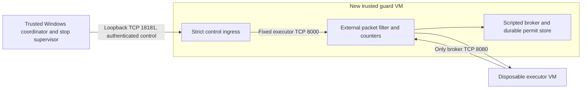

# Proposed Windows validation network boundary

Status: **Accepted for preparation — provisioning and qualification pending.** On November 21, 2026, the developer selected “Prepare the guard VM topology” in the thread's explicit decision request. Scope is the synthetic M1-12 validation deployment, not selection of the product implementation stack. This decision itself changes no VM, adapter, firewall or service.

November 22 update: [disconnected guard creation](../../research/validation/guard-preparation-plan.md)
was separately approved and completed. Boot, installation/hardening and network
qualification remain open; the topology decision itself grants none of those actions.

## Recorded decision

Prepare a small trusted guard VM alongside the already selected executor VM. It will host the scripted broker and a narrow control ingress, with filtering outside the executor's kernel. The alternative considered was the original separate Linux runner with host-side VM filtering. Do not replace the requirement with an executor-local firewall or with Docker Desktop's offline startup check.

| Option | Practical effect | Outstanding decision |
| --- | --- | --- |
| Dedicated guard VM on this Windows/VirtualBox host | Reuses the current executor target and prepared image; adds a trusted guest kernel, broker/control services and independently observed packet policy. | Selected for preparation. Exact VM creation/installation and final tests need separate concrete review. |
| Dedicated Linux runner | Follows the M1-06 reference topology directly and can enforce at its host bridge. | Not selected for this preparation stage. |

## Why the current NIC settings are insufficient

The [M1-06 boundary](../../research/execution-security-boundary.md#environment-and-permissions) assumes the entire executor guest can be compromised. Its own firewall cannot be the final authority. VirtualBox internal networking connects selected VMs without a host application interface, while host-only includes the host. The internal switch itself does not implement the required destination policy. Ordinary NAT also exposes routes beyond the scripted broker. [Oracle networking documentation](https://docs.oracle.com/en/virtualization/virtualbox/7.2/user/networkingdetails.html)

## Recommended topology to prepare

The guard is an independent enforcement point outside the executor VM. It is trusted like the runner host in M1-06 and is never a task workspace or artifact extractor. A separate disposable extractor remains required for untrusted stopped disks. Sharing one physical hypervisor leaves the existing hypervisor/residual-risk constraint in place.

Proposed preparation identity is `mcli1-guard-01`, one vCPU/1 GiB RAM, a dedicated disk and no shared folders, clipboard, drag-and-drop, USB or management sockets. Actual image/package digests, UUID and device names must be frozen before a provisioning action. The executor retains its approved proposed two-vCPU/4 GiB profile; no change is made now.

Use one new, uniquely named internal switch, `mcli1-validation-net-01`, with exactly the executor and guard attached. Candidate synthetic addresses are guard `192.0.2.1/30` and executor `192.0.2.2/30`, with fixed MACs and permanent neighbors. The executor has no second NIC, default route, DHCP, DNS or host-only/NAT attachment. The guard's internal interface is the broker/filter endpoint. Freeze NIC identities and prove there are no additional switch participants.

For coordinator ingress, the guard alone gets a separate ordinary NAT adapter with a loopback-bound VirtualBox forwarding rule: host `127.0.0.1:18181` to guard control TCP 8081. The guard uses a static address on that adapter, with **no default route or DNS**. Its input/output rules permit the management exchange only; forwarding is disabled and the forward chain drops everything. The executor has no direct attachment to this NAT network. This requires neither reuse of the existing host-only adapter nor a new Windows host adapter. Port availability, actual forwarded source address and effective route tables are measurements to obtain before freezing rules.

The NAT mode supplies a management transport, not the executor's egress policy. Enforce default drop on both guard interfaces and on IPv4/IPv6, verify no public route/delivery, and preserve interface counters and independent receiver observations. No bridged/LAN attachment, external provider or general forwarder is included. If these checks fail, keep all dependent execution blocked.

## Allowed exchanges and fencing

| Origin | Destination | Permission |
| --- | --- | --- |
| Coordinator loopback ingress | Guard TCP 8081 | Authenticated, bounded fixture control methods, exact attempt/conversation grants and request hashes. A private control credential stays outside the executor and is never forwarded to Agent Server. |
| Guard control service | Executor `192.0.2.2:8000` | One fixed address/port. Forward only authorized control routes and replace the backend credential with a disposable dummy value. No caller-selected target, generic proxy or tunnel. |
| Executor `192.0.2.2` | Guard `192.0.2.1:8080` | Attempt-bound, bounded scripted Chat requests under durable one-use permits; zero upstream forwarding. |
| Executor | All other addresses, ports and EtherTypes | Deny; include spoofed identities, IPv6, DNS, metadata, host management, LAN, other guests, registries and alternative broker routes. |
| Any participant | Guest/host runtime management sockets or authoritative Git/ledger/planning stores | No exposure or mount. |

The guard is a local endpoint and application proxy, not a router. Linux local input/output and forwarding are distinct paths; each relevant hook needs its own policy. Early ingress filtering also needs an explicit fragmentation policy because transport headers are absent from noninitial fragments. [Netfilter hook documentation](https://wiki.nftables.org/wiki-nftables/index.php/Netfilter_hooks)

Reject source MAC/IP mismatches, unexpected VLANs, IPv6 and fragments rather than granting a broad established-connection exception. A fenced attempt must fail the active-attempt test before any broker established-flow allowance, close active application streams and revoke permits. Preserve control access only for observation/stop after fencing. Freeze the generated nftables bytes, kernel/userspace versions and policy counters; source review is not proof that the filter works.

The external Windows supervisor owns the absolute VM lease and forced stop. A separate guard deadman denies broker traffic if authority expires or its control connection fails, while the Windows supervisor stops the executor independently. A guard crash must remove the broker path; it must never cause bypass or another route. Qualify coordinator crash, guard crash, expired/fenced authority and delayed traffic before relying on either control.

## Qualification and approval boundary

Before connecting an executor NIC, qualify the guard policy using trusted synthetic senders and receivers, with allowed/forbidden services demonstrably alive. Show denied direct socket/syscall traffic, anti-spoofing and IPv4/IPv6 counters, permitted broker/control exchanges, active-stream fencing and unchanged protected targets. Then repeat all M1-12 A–E cases on the exact final guest/container/tool profile, including the allowed edit and stop/cleanup. The [fixture order](../../research/two-task-validation-fixture.md#execution-order-and-prerequisite-gates) and #13 metering gates still apply.

Approval here selects a topology for preparation only. It does not approve creating a VM, installing packages, enabling a NIC, a paid/provider experiment, product architecture adoption or dispatching a task. Those actions need their concrete pins, effective controls and applicable approval. If the developer chooses the Linux-runner option, retain this proposal as superseded and prepare that target instead.

## Next independent work

Finish the strict two-tool conversation/control admission preparation on synthetic bytes, then prepare the exact guard VM/image/package and packet-policy inputs for provisioning review. Exact deployed SDK schemas, request transcripts, guest readiness/hardening, external observer/extractor controls and final run approval remain open.
