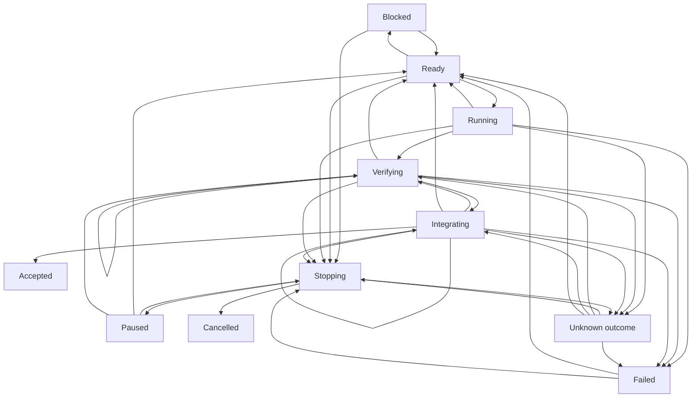

# M1-07 Autonomy, approval, and recovery rules

**Recommendation — Conditional.** Design the synthetic proof of concept around a durable coordinator with one active task per milestone. It may execute, verify, integrate, and correct work within a frozen developer approval. It must stop when authority, effects, or spending exposure cannot be established. Unattended execution depends on the measured gates below. [Issue #7][i7] · [M1-05 handoff](planning-execution-handoff.md)

## Evidence and scope

| Classification | Baseline |
| --- | --- |
| **Source-confirmed** | OpenHands SDK and Agent Server `v1.62.0`, commit `504a88cab0fb48ee5226238ad7b8f1d865fa84a8`, using the local conversation runtime inside the dedicated Linux VM boundary proposed in M1-06. The pinned SDK lock selects LiteLLM `1.105.1`. [OpenHands release][oh-release] · [SDK lock][oh-lock] · [Executor research](openhands.md) · [Security boundary](execution-security-boundary.md) |
| **Source-confirmed** | GSD Core `v1.21.0`, commit `357508df233ccca0dcf4332b385d6bee9b113da9`, supplies versioned planning inputs. Its native workflow can write planning and Git state. The coordinator imports a frozen snapshot and raw task plans through the M1-05 contract. [Pinned planning schema][gsd-plan] · [GSD research](gsd-core.md) |
| **Source-confirmed** | Git supports an expected-old-object check for ref updates. OpenRouter documents Chat generation IDs and lookup of usage by generation ID. Hosted API review date is 2026-11-17. Issue #11 uses a scripted local broker. [Git ref updates][git-cas] · [OpenRouter Chat][or-chat] · [Generation lookup][or-gen] · [Routing research](model-routing.md) |
| **Measured** | No runtime results. This is source review and a proposed coordinator policy. Test outcomes below are pass criteria. |
| **Open** | Safe fencing, durable recovery, exact revision acceptance, and accounting under faults must be demonstrated on the selected deployment. The [open gates](#outstanding-risks-and-dependencies) identify the next checks. |

The policy follows the [vision](../docs/vision.md), [draft requirements](../docs/requirements.md), and [draft architecture](../docs/architecture.md). Issue #8 defines verification and integration evidence, #9 defines spending limits and settlement, #10 freezes the two-task fixture and numeric limits, and #11 measures executor cancellation and restart recovery. [Issue #8][i8] · [Issue #9][i9] · [Issue #10][i10] · [Issue #11][i11]

## Lifecycle and persisted state

- **Task revision.** The coordinator owns readiness, dependencies, approval, and acceptance for each task in a frozen plan revision. `Blocked` covers missing approval or predecessor acceptance. `Ready` means eligible for admission. `Running` includes dispatch and execution. `Verifying` and `Integrating` are distinct gates. `Stopping` keeps the requested disposition while the coordinator disables execution and checks effects. `Paused` is a proven stop with a recoverable checkpoint or sufficient evidence to start clean. `Unknown outcome` is a hold for uncertain delivery, stop, effects, promotion, or spend. `Failed` is a known failure with no automatic retry available. `Cancelled` ends the task revision after reconciliation. `Accepted` records verified integration.
- **Attempt.** An attempt starts with reserved limits and an immutable input, runtime and conversation binding. Its coordinator phases are `Reserved`, `Dispatching`, `Executing`, `Stopping`, `Suspended`, `Completed`, `Failed`, `Interrupted`, and `Unknown outcome`. `Completed` means there is a sealed candidate or equivalent complete execution receipt. Its task can still fail verification. `Suspended` retains a checkpoint eligible for explicit resume. `Interrupted` is a closed attempt with a recorded reason and effects. `Unknown outcome` holds the attempt or operation with unresolved evidence. Retries create new attempt IDs and UUIDs. A qualified resume uses the same attempt and UUID, a new run-operation ID, and fresh runtime authority. Verification and integration keep separate operation records linked to the candidate attempt.
- **Executor.** Native status, the conversation UUID, event IDs, runtime inventory, and tool and model observations are evidence. A conversation can run multiple times. The pinned run route has a conversation UUID and a success response. Store the coordinator's run-operation ID with observed native IDs and events, and record a missing native run ID explicitly. Native `paused`, `finished`, `error`, or `waiting_for_confirmation` leaves the coordinator to decide the task transition. [Native states][oh-state] · [Run route][oh-run] · [Remote completion handling][oh-finish]

Persist an ordered transition history with the actor, reason, prior and next state, record version, approval and authority generation, operation and evidence IDs, and time. In the same durable admission write, claim the task, allocate the attempt and conversation UUID, and reserve limits. Persist separate intents before provisioning, each executor mutation, each model submission, permitted external tool effects, and candidate or milestone ref updates. Link the operation to its expected input, bounded effect, idempotency key where supported, and reconciliation deadline. Store effect receipts and charge settlement with their own identities. Evidence and attempts survive supersession, restart, and cleanup.

### Task state diagram

### Task transition table

The coordinator commits every transition. Developer instructions set the desired disposition, and boundary services and verifiers supply evidence. Process events and Git observations can arrive in any order. Evaluate them against the persisted state and authority generation. A committed pause, cancel, or revocation blocks new admissions and promotions before any later worker result is evaluated. An already-issued operation goes through reconciliation. A milestone hold also blocks downstream tasks, including those whose eligibility was computed earlier.

Use this decision order after each event or restart. Restore effective authority and any stop disposition first. Record incoming observations against their original operation. If a stop governs, fence and follow `Stopping`, or keep `Unknown outcome` when the stop or effects cannot be proved. Otherwise resolve outstanding uncertainty before testing any success or retry gate. Advance on matching evidence, retry an eligible known failure within limits, or record `Failed` when a known failure has no permitted correction. Wait for evidence while a valid operation is still in flight and apply its recorded deadline. Deduplicate repeated notifications against the existing observation and transition history.

| From → to | Trigger and action owner | Required evidence and preconditions | Persisted change | Permitted next action and intervention |
| --- | --- | --- | --- | --- |
| Blocked → Ready | Scheduler evaluates gates | Current approval, matching scope, accepted predecessors and their exact integration inputs, no hold | Readiness proof and assigned base | Attempt admission. Missing authorization goes to the developer when a decision is needed. |
| Ready → Blocked | Scheduler finds a changed gate before admission | Changed base, dependency, approval, or policy and no live attempt | Invalidate readiness and record blocker | Recompute once gates return. Get fresh approval for changed approved intent or policy. |
| Ready → Running | Scheduler claims the task | Current readiness, available limits, and prior resource cleanup or an eligible isolated checkpoint | Atomically write claim, attempt or resume binding, authority generation, counters/reservation, and initial intent | Dispatch under the live grant. A losing claimant observes the winning record. |
| Running → Verifying | Adapter reports completion or recovery yields a candidate | Runtime fenced and stopped, effects and spend reconciled, artifact intake passed, cleanup verified, sealed candidate tied to approved input | Close attempt as completed and record candidate/effect receipts | Run checks and review for this candidate. Ambiguity goes to `Unknown outcome`. |
| Verifying → Integrating | Coordinator validates independent verdicts | Mandatory tests and independent review pass for the same candidate, task, rubric and check profile | Store verdicts, integration base and staging intent | Stage against the expected head and test the proposed integrated commit. |
| Verifying → Verifying or Integrating → Integrating | Coordinator observes a confirmed transient failure of a check or staging operation | Immutable inputs still match, prior operation and spend are reconciled, and an operation retry is available | Close the prior operation, account for the retry and persist a new intent on the same inputs | Retry the affected operation within the approved limits. Hold further execution if evidence or authority changes. |
| Integrating → Verifying | Coordinator detects changed candidate, evidence profile, or integration input that invalidates evidence | Staged changes contained and reconciled, no unresolved ref promotion, revised input still within grant | Supersede the affected evidence and record reason, new revision and expected head | Collect fresh applicable evidence. Pause and seek approval if the change crosses scope or policy. |
| Integrating → Accepted | Trusted Git writer and coordinator complete promotion | Current approval, exact integrated regression pass, applicable candidate evidence, expected-old-ref update and independently observed expected new OID | Close promotion intent, commit durable acceptance with evidence and integrated OID, and release dependent eligibility in that order | Dependent admission rechecks this acceptance and base. Resolve any ambiguous promotion first. |
| Blocked / Ready / Running / Verifying / Integrating / Paused / Failed → Stopping | Developer pauses, cancels, redirects or revokes, or coordinator enforces a safety stop | Durable decision or policy trip. Include any work, verifier, or pending mutation in scope | Record requested disposition, hold and revoke the affected authority generation. Mark live attempts stopping | Fence resources, observe and reconcile. Active work may leave effects. Developer input is needed for a policy exception or unresolved effects. |
| Stopping → Paused / Cancelled | Coordinator verifies stop and effect disposition | Runtime and tools proven stopped, old authority disabled, pending operations and spend reconciled or explicitly disposed within enforced bounds | Seal stop and effect evidence. For pause retain eligible checkpoint, candidate or clean baseline. For cancellation close active attempt with reason and record artifact disposition | Preserve evidence before approved cleanup. Pause waits for explicit resume. Cancellation is terminal for this task revision. |
| Paused → Ready / Verifying | Developer resumes and coordinator revalidates grant | Current authority, reconciled effects and spend, satisfied dependencies, verified cleanup for a fresh attempt or a proven safe checkpoint. A sealed candidate may go directly to verification | Record resume tied to current revisions and clear hold. Carry forward consumed limits | Admit or verify within current limits. Changed scope or policy needs new approval. Pending native confirmation has its own gate. |
| Running / Verifying / Integrating → Ready | Coordinator classifies a known failure that requires an execution correction | Durable diagnosis, no live writer, prior effects and charge settled, cleanup verified, correction in scope and authorized quota available | Close failed execution or verification operation, retain failed candidate and evidence, record next eligible correction and earliest retry time | Use a fresh attempt for the authorized correction. |
| Running / Verifying / Integrating → Failed | Coordinator classifies a known failure with no permitted automatic repair | Failure evidence, prior operations reconciled, old authority stopped, and permanent failure, policy denial or exhausted limits | Record failure, counters, evidence, and intervention reference | Developer can cancel, revise, or authorize a specific in-scope correction if feasible. |
| Failed → Ready | Developer authorizes continued work on the same revision | Exact revised limits or approved correction, resolved blocker, current dependencies and all safety gates | Append new authorization and reopening decision. Preserve prior counters and history | Admit within the new absolute limits. Scope redirection creates a successor revision. |
| Running / Stopping / Verifying / Integrating → Unknown outcome | Coordinator detects possible delivery or effects without conclusive evidence | Missing or conflicting evidence, loss of runtime or catalog ownership, or an unresolved spend/ref mutation | Keep pending intents and reservations, fence the affected execution paths, record disposition, evidence gaps, and deadline | Read-only inspection and stop controls. Escalate at the deadline or earlier when essential evidence cannot be recovered. |
| Unknown outcome → Stopping / Verifying / Integrating / Ready / Failed | Coordinator resolves the pending operation or records an authorized disposition | `Stopping` if pause, cancel, revocation or other stop still governs. Otherwise use the corresponding entry criteria. `Ready` requires a safe continuation and available limits. `Failed` requires a known failure. Recovered promotion goes through `Integrating` before acceptance | Store evidence of applied, absent, or partial effect, or the precise residual unknown and authorized disposition. Preserve the original operation and accounting history | Follow the destination's gates. Any restart with unreconciled prior effects requires a developer decision and technical containment. No path authorizes replay of an ambiguous operation. |

`Accepted` and `Cancelled` are terminal for their task revision. Scope changes create successor records in `Blocked`. Prior acceptance remains audit evidence for its original revision. Any reuse requires explicit mapping of the integrated base and fresh applicable verification under the revised plan. A milestone pause can apply after a task was accepted and still hold every later dispatch.

## Approval and authority

An approval is an authenticated, immutable developer decision tied to the frozen plan and task/criteria digests, repository and baseline, intended predecessor rule and target ref, and policy/profile revisions. Bind allowed write paths, tools, destinations and data classes, model profiles and fallbacks, check and review policy, runtime isolation, expiry, deadlines, and request/task/milestone ceilings for attempts and spend. An exception names the exact action, scope and expiry. A release decision binds the verified revision, artifact digests, version and publication destination.

Record every approval, replacement, pause, cancellation and revocation as a durable ordered decision with approver, time, reason and affected scope. Advance a monotonically increasing authority generation for the affected scope and invalidate old grants on replacement or revocation. Pause disables execution while retaining the underlying plan approval for possible explicit resume. At startup, rebuild effective authority from durable decisions before enabling dispatch. The coordinator and trusted mutation gates reject stale workers and stale grants. Check again at model admission, tool authority, native run or confirmation, and ref promotion. Serialize that check and effect issuance with pause and revocation. Runtime fencing removes old access independently of coordinator process health. Already-admitted requests may complete at their destination and must be reconciled.

| Decision or operation | Authority and permitted automation | Developer gate |
| --- | --- | --- |
| Project direction and plan | Developer owns scope and architecture. GSD supplies draft planning artifacts. Coordinator imports and schedules the approved revision. | Initial approval, requirements or scope change, and major architectural change require approval of the exact revised proposal. |
| Lifecycle transitions | Coordinator owns task and attempt state, dependency release, dispatch, reconciliation, and history. It handles authorized retries and routine stops. | Developer commands pause, resume, cancel, and redirect. A coordinator safety stop requires a developer decision when the blocker calls for an exception or unresolved-risk disposition. |
| Executor operations | Trusted adapter starts and observes isolated OpenHands conversations. OpenHands uses approved tools and the broker in its assigned runtime. Host supervisor enforces revocation and teardown. | Significant policy or security exceptions require explicit approval. A pending native confirmation requires a decision on the actual action before the adapter answers it. Routine covered actions run under the approved profile. |
| Git and artifacts | Executor writes approved files in a disposable workspace. Trusted intake seals artifacts. Coordinator's trusted Git writer creates and promotes candidate/integration refs with verified inputs. | Approval is required for work outside the bound paths or target, expanded Git authority, or cleanup outside the approved disposition. |
| Verification | Check runner and independent reviewer supply evidence. Coordinator applies the approved rubric to the exact candidate and integrated revisions and records acceptance. | A change to approved criteria, checks, or review policy requires renewed authorization. A developer disposition cannot convert missing or stale evidence into a pass. |
| Retry and budget enforcement | Coordinator and broker enforce cumulative attempt, request and exposure limits. In-scope correction, reconciliation and retry within those limits are automatic when evidence permits. | Exceeding authorized retries, spend or exposure, and restarting with unreconciled prior effects require explicit, bounded authorization. Unbounded exposure blocks dispatch. |
| Release | Coordinator prepares artifacts and evidence. A trusted release path acts on an explicit developer authorization. | Every publication requires an exact-target release decision. A changed artifact, revision, version or destination needs a new decision. Publication is outside the synthetic proof of concept. |

## Recovery invariants and retry policy

1. **Write intent before effect.** Use a single durable claim per task revision and one operation identity per logical effect. Persist possible delivery before allowing external I/O. A replacement worker reconciles issued intents first. A claim timeout alone grants no permission to issue a new mutation. Send operations through a trusted gate that enforces claim and authority generation, disables transport-level replay of mutating calls, and records delivery evidence. The pre-send crash window can conservatively produce `Unknown outcome`.
2. **Reconcile ambiguity.** A lost acknowledgment, timeout, missing event, `404`, `409`, or recovered native error supplies evidence for investigation. Require independent proof of the expected effect, authoritative proof of non-delivery or absence, or a documented partial/ambiguous outcome. Replay requires proof of non-delivery/absence after fencing all old writers, or a qualified end-to-end idempotency contract with the same key and intent. A discovered duplicate stops affected writers and quarantines competing receipts, artifacts and charges for reconciliation.
3. **Fence before reuse.** Disable the old authority at the runner and broker, with a host-side expiry or stop path that works while the coordinator is down. Verify termination of tool processes and descendants across the runtime boundary, and verify that old access cannot admit another request. For the proposed VM profile, a host-attributed VM stop and reaped process plus broker/NIC revocation are the canonical evidence. Graceful drainage is an optimization. Without stop proof, hold workspace reuse, destructive cleanup, launch and promotion. The same rule covers verification processes and any previous coordinator worker capable of sending mutations. [Security boundary](execution-security-boundary.md#minimum-secure-proof-of-concept)
4. **Constrain tool effects to what can be observed.** Launch intent grants bounded local writes to a dedicated disposable volume, with a base and approved path manifest. Arbitrary terminal commands have no reliable per-action idempotency token at the pinned native boundary. Contain them and reconcile their actual filesystem effects after stop. A tool that mutates anything outside that volume must go through an approved trusted gate that journals each action before execution and can query or deduplicate its effect. The synthetic profile denies other destinations. Conversation and guest logs aid diagnosis. Trusted observers establish effects and stop.
5. **Bind verification and promotion to revisions.** Seal the candidate from trusted intake, validate checks and independent review on that candidate, and validate regressions on the proposed integrated revision. Re-evaluate evidence after a candidate, approved criteria, applicable check/rubric profile, or integration-input change. Persist the exact acceptance and integrated OID before making a successor runnable. [Issue #8][i8] · [M1-05 verification](planning-execution-handoff.md#dispatch-observation-and-integration)
6. **Keep unknown cost visible.** Reserve a defensible upper bound before every submission, including review and auxiliary calls. Distinguish reported charges, estimates, pending settlement and unknown cost. Hold the reservation and block additional milestone submissions for uncertain spend. Settle charges once by scoped generation ID when available. Release a reservation only on evidenced settlement or non-delivery. A developer can dispose of bounded uncertainty by keeping its upper bound charged against the authorization. Unknown cost remains unknown in reports. [Issue #9][i9] · [Generation lookup][or-gen]

Each approval sets an initial attempt allowance and a finite number of corrections, plus separate request/role, wall-time, exposure, and reconciliation limits. Charge an allocated attempt slot when its reservation is committed. Each new attempt consumes another slot, including after interruption. An explicitly authorized same-attempt resume consumes a separately bounded run-trigger allowance and remains subject to the original deadline and cumulative spend. Count model submissions and any allowed transport retry or fallback against the approved request limits and exposure. Record any proved non-delivery, preserving the attempt and counter history. Restarts and revised approvals carry forward accrued attempts and exposure. Issue #10 sets the fixture values for approval. The retry-exhaustion test below proposes one initial attempt and two corrections.

An evidenced, in-scope failure may enter correction when the approved limits permit it and a concrete remediation is available. A transient infrastructure retry needs evidence of safe continuation and uses a bounded delay within the deadline. A policy denial, permanent error, lack of a viable correction, or exhausted limit stops automatic correction. Unknown delivery, write effects or spend enters reconciliation with a persisted deadline. At expiry, preserve the hold and escalate. Approval can authorize a bounded alternative that excludes the uncertain operation after containment. Where containment, spending bounds, or required verification are still missing, keep execution held.

### Native behavior and the replay boundary

| Operation | Source-confirmed behavior or open contract | Coordinator rule |
| --- | --- | --- |
| Create conversation | Caller supplies a UUID. The service can reuse an existing conversation. An initial message can start work as part of creation. [Create request][oh-request] · [Creation and reuse][oh-create] | Use a preassigned UUID, exact workspace/profile, `worktree: false`, and omit `initial_message`. Reconcile via `GET C` and trusted runtime inventory. Only reuse or reissue create under the original verified deployment/catalog binding and fenced ownership. |
| Deliver message and run | `POST C/events` accepts `run: false`. `POST C/run` starts background execution and can return `409` for an active run. Neither reviewed request declares an operation idempotency key. [Message route][oh-message] · [Run route][oh-run] | Persist separate intents. Match a unique task message using its operation marker and payload digest, and compare subsequent events, status and runtime/broker observations. A second trigger can start another run after the first ends. Delivery ambiguity holds the task. |
| Pause, interrupt, reattach and resume | `POST C/pause` is cooperative. `POST C/interrupt` signals cancellation, with bounded server-side waiting and a cooperative fallback. The local runtime exposes `can_resume`. Restart can mark stale `running` as `error` and write a synthetic observation for an unmatched action. [Stop routes][oh-stop] · [Drain behavior][oh-drain] · [Runtime lookup][oh-runtime] · [Restart recovery][oh-restart] | Use native stop for graceful signaling and the supervisor for verified fencing. Read-only lookup and event backfill may diagnose delivery and effects. The baseline resumes the task in a fresh executor or verifies a recovered candidate. Same-conversation continuation is an open capability and requires a separately qualified checkpoint path that fences the former runtime. |
| Native confirmation | A subsequent run can implicitly confirm pending actions. `POST C/events/respond_to_confirmation` accepts or rejects confirmation. [Implicit confirmation][oh-implicit] · [Confirmation route][oh-confirm] | Suppress automatic `/run` for pending or uncertain confirmation. Validate the developer's decision, exact pending action IDs, current grant and allowed effect. Journal the confirmation call separately. Treat an ambiguous response as possible advancement and inspect it before further action. |
| Tool writes and other mutations | **Open** for any external tool's exact deduplication contract. Raw shell append, arbitrary commands, and general message and run triggers lack a reliable replay key for this profile. [Message route][oh-message] · [Run route][oh-run] · [Execution security research](execution-security-boundary.md) | Independently inventory filesystem effects and use per-operation receipts for approved fixture services. Only enable external mutations with a qualified enforcement and observation path. Any later release API needs its own replay/reconciliation contract. |
| Inference retry and billing | The pinned SDK has its own transient retry wrapper and optional fallback. OpenRouter documents generation lookup by ID. A dropped response can leave ID and usage unavailable. No replay deduplication guarantee is established for ambiguous Chat submissions. [SDK retry wrapper][oh-retry] · [Chat API][or-chat] · [Generation lookup][or-gen] | Set `num_retries: 0`, leave SDK fallback unset and pin one fixture route. Measure the actual submission count for every used role. A charge or possible charge survives executor cancellation. |
| Candidate seal and integration ref write | Git supports updating a ref only when it has an expected old object ID. The coordinator ledger and Git have separate commit boundaries. [Git ref updates][git-cas] | Journal candidate base/tree and expected old/new ref OIDs before the mutation. Compare ref, commits, parents, tree and evidence after restart. An expected new ref with matching provenance is an observed effect. At the expected old ref, issue the update only if authorized and the original writer is fenced. Divergence holds work for reconciliation. |

Here `C` is `/api/conversations/{uuid}`. Observe with `GET C`, `GET C/runtime`, `WS /sockets/events/{uuid}` and paginated `GET C/events/search`. Deduplicate persisted events by deployment, UUID and event ID. Capture event gaps and compare executor evidence with the runner, workspace, broker and Git. [Conversation lookup][oh-lookup] · [Event socket][oh-socket] · [Event history][oh-events]

## Failure and recovery walkthroughs

### A. Developer pauses during an OpenHands run

1. The coordinator records the developer command and milestone hold, moves the task to `Stopping`, and invalidates the active grant. The dispatcher stops admitting attempts immediately. The runner and broker disable new effects under the old grant. The adapter records and sends `POST C/interrupt` over the trusted control path. It may use native pause for cooperative signaling if that policy is approved.
2. The supervisor checks the runtime and descendants against the stop deadline. If graceful stop is incomplete, force the dedicated VM off and verify termination and revocation. Interrupt acknowledgment and native status are diagnostic. Record late writes and already-admitted broker requests through the verified stop boundary. A timeout or unverifiable stop/effect moves the task to `Unknown outcome`. Preserve the workspace and evidence for investigation.
3. Once stopped, intake inventories the candidate and reconciles effects and spend. The coordinator records `Paused` and preserves approved recovery material before cleanup. On explicit developer resume under the unchanged plan, continue verification from a valid sealed candidate or dispatch a fresh attempt from a clean baseline within the remaining allowance. A qualified native checkpoint needs unchanged input and profile, current authority, established process stop, and no unapproved pending action. The original approval covers ordinary resume within limits. Changed authority, an exception or unresolved effects requires a developer decision.

### B. Developer redirects scope during a milestone

1. The coordinator commits revocation of the affected plan approval and increments its authority generation. Hold the milestone and affected successors. Stop implementation and any active verification under the previous approval. Reject promotion of results arriving after revocation. A promotion issued before revocation is reconciled as an observed effect and cannot release dependents under the revoked plan.
2. The adapter and supervisor fence and stop old attempts. The coordinator preserves their events, charges, candidates and any integrated commits, then records known, partial or unknown effects. Cancel the reconciled task revisions for the superseded scope. An unresolved promotion or effect holds the affected work. Preserve the existing Git history and show the developer any applied change that the revised plan may need to keep or reverse through a new approved change.
3. Import a new frozen plan and establish its baseline from observed repository state. Present changed requirements, tasks, dependencies, checks, retained work, and current usage and limits for exact revision approval. Require fresh applicable verification before any old result serves as a new predecessor. A stale executor, a saved approval for the old plan, and a cached verdict cannot advance the new revision, including after coordinator restart.

### C. Correction attempts exhaust the retry budget

1. With one initial attempt and two authorized corrections, an independent check rejects the first sealed candidate. The coordinator records the failing criterion, exact candidate and logs, proves the attempt is stopped, settles any charge and confirms a concrete in-scope fix. It moves through `Ready` and consumes the first correction slot at admission. Apply the same decision after the second known failure when the evidence supports another correction.
2. If the third candidate fails, the coordinator records `Failed` and holds dependent work. No fourth dispatch, fallback or native rerun is admitted. Retain each attempt ID and UUID, base and candidate OIDs, relevant event and check artifacts, correction rationale, retry count, elapsed time, usage, and cleanup evidence. Any possible write or charge with insufficient evidence instead keeps the affected task at `Unknown outcome`.
3. Show the developer the recurring failure, work that exists, remaining uncertainty, and available choices. Cancellation ends the task. A specific approved correction with a higher absolute ceiling can reopen the same revision after the safety gates pass. Changed requirements use a newly approved revision. The old attempts and costs continue to count toward their applicable limits.

### D. Coordinator crashes after a side effect

1. The run intent already identifies the UUID, input tree, expected writable paths and runtime. A fixture terminal append writes an operation marker to the assigned volume. The coordinator dies before recording the result. A recovery worker starts in observation mode and sees the unresolved run intent. It restores pause and approval state, fences the old dispatcher and executor, and confirms all relevant writers stopped before inspecting canonical state. If the Agent Server also crashed, a recovered synthetic tool error still leaves the marker effect possible.
2. Compare `GET C` and persisted events with a trusted offline manifest and marker count. A single matching effect with the expected base and artifact hash is recorded once as observed. Carry a complete eligible candidate to fresh verification. A partial result is retained and requires a correction decision with reconciled effects and limits. If independent evidence proves no effect and the old writer is fenced, an authorized fresh attempt can run. An unavailable disk, conflicting marker count, or loss of provenance keeps the task at `Unknown outcome`, with a developer intervention once bounded checks finish. Any fresh attempt that proceeds under an approved residual-risk disposition must avoid the uncertain effect and use a separately contained path.
3. For an ambiguous create response, inspect the preassigned UUID and deployment/catalog identity. For a lost message or run response, match the operation and observe events, tool or broker activity, and effect counters. Finding the message can settle delivery without settling execution. Keep any ambiguous operation pending without resending its POST. If the model request may have reached a provider, keep its reservation even when the workspace is clean. Poll a saved generation ID within the reconciliation deadline. With no ID or conclusive ledger match, retain unknown cost and block further submissions. A duplicate effect or charge is investigated against the original operation and never erased from the record.

### Developer intervention example

| Field | Example |
| --- | --- |
| Decision context | `INT-04` · Plan `P2` · Approval `AP-02` · Task `T-01` · Attempt `A-03` · Model submission `MS-07`. Task is `Unknown outcome`. `T-02` is held. |
| Problem and known effects | The run lost its response after sending `MS-07`. The supervisor confirmed VM stop and broker revocation. A read-only manifest matches the fixture base. No candidate or integration ref advanced. |
| Uncertainty and evidence | The broker received the request and lost the response before capturing a generation ID. No unique settlement match by the deadline. Reported cost is unknown. The synthetic ledger retains 2 units of maximum exposure. Link the pending intent, stop receipt, manifest and scoped broker evidence. |
| Choices and consequences | Hold for a settlement record. Cancel the task and retain the unresolved charge in the report. Authorize a fresh attempt on the approved isolated route if that path avoids the uncertain operation, the extra submission fits the absolute limit with the 2-unit reserve, and all other gates pass. |
| Decision record | Capture authenticated developer, selected disposition, affected revision and operation IDs, reason, allowed action and target, exposure ceiling, expiry and time. Apply only against the current authority generation and keep the decision in history. |

## Issue #11 validation specifications

**Open.** Use the #10 two-task fixture and final approved limits. Pin the source commits, OpenHands server/image, LiteLLM, runner/VM policy, scripts, broker transcript, test tools and approval digest. Start each case from the same committed fixture and a fresh journal and runtime. T-02 depends on T-01's durable verified integration. Use a local scripted Chat endpoint, dummy identities and no external egress. The pinned OpenHands parity test gives a scripted-model starting point. [Issue #10][i10] · [Issue #11][i11] · [Pinned parity fixture][oh-fixture]

Use fixture barriers with explicit release signals to inject faults. For a write-before-recording case, a test command appends one line containing the logical operation ID to a declared scratch marker, flushes it, signals an independent fixture observer and waits before returning its tool observation. The observer and trace collector survive the coordinator failure. Delay or drop selected responses after request forwarding at a synthetic control proxy. Use a finite deadline for every barrier and record the exact trigger. Prove that the relevant action was reached with a positive control or trusted barrier receipt.

For every case capture ordered transition and approval records, attempt and run-operation IDs, deployment and conversation UUID, native status and event IDs, HTTP delivery evidence, broker submissions and available usage (including missing fields), VM/process and revocation receipts, marker counts, base/candidate/integrated OIDs, artifact hashes, cleanup receipts, and dependent admission timestamps. Store only fixture data and sanitized logs. Compare evidence from independent observers. Report **pass**, **fail**, or **inconclusive** per case. Missing fault injection or missing required evidence is inconclusive. A forbidden retry, late write after proven stop, unapproved submission, or premature dependency release fails.

| Case | Setup and fault injection | Expected transitions | Evidence and pass/fail criteria |
| --- | --- | --- | --- |
| 1. Successful execution | Approve the frozen baseline. Script T-01 to edit the allowed files and pass checks. Run independent review and integrated regressions, then T-02. No fault in the control. | Each task follows `Blocked → Ready → Running → Verifying → Integrating → Accepted`. | One T-01 attempt, one logical dispatch, expected sealed diff and integrated OID, exact independent verdicts, and both receipts. T-02 starts from the accepted T-01 OID after the acceptance record. Mutate the candidate after a verdict and inject a failed integrated check in separate runs. Stale evidence returns to verification and the failed regression blocks promotion and dependent admission. |
| 2. Pause and safe resume | Script a bounded terminal writer with an observable child and a separate variant stalled on a model response. Commit a developer pause at the barrier. Restart the coordinator while paused, then issue resume. In a variant, arrange a native pending confirmation and withhold the developer's action decision. | `Running → Stopping → Paused`. Explicit resume permits `Ready` and a newly authorized attempt or `Verifying` with a sealed candidate. Keep pending native actions held. | Measure `POST C/interrupt` acknowledgment, last tool activity, broker revocation and supervisor-confirmed stop. Prove zero old-authority writes/submissions after confirmed stop, no launch or workspace reuse while stopping or paused, and correct retry/resume accounting. Capture `GET C/runtime` and test same-UUID attach and resume separately under a proven checkpoint/fence. No automatic `/run` or action execution while confirmation is pending. |
| 3. Cancellation during a tool operation | Tool appends one marker, spawns a bounded child capable of writing a second marker, and waits. Cancel after the first write. Hold the child and challenge the stop gate both before and after supervisor stop. | `Running → Stopping → Cancelled` after stop and effect accounting. Use `Unknown outcome` if stop or effects cannot be proved. | Verify the first effect is recorded, any in-flight writes before stop are inventoried, old access is rejected, and neither writer can modify state after proven stop. Cancelled revision cannot restart or unblock T-02. Capture whether native interrupt bounded drain suffices or forced VM stop is needed. |
| 4. Crash after a side effect | Kill the coordinator after the independent append barrier and before its receipt. Run a second variant that also kills Agent Server before the tool observation with conversation persistence available for isolated lookup. Inject separate crashes after writing the candidate ref and after promoting the integration ref, before recording results. | Recovery holds dispatch until reconciliation. One proven sealed candidate goes to `Verifying`. An observed promotion returns through `Integrating` and can reach `Accepted` only with current approval/evidence. Incomplete evidence holds `Unknown outcome`. | Exactly one append and one resulting receipt, with intended base/manifest and stop proof. Compare native lookup, events and any recovered synthetic error with the independent marker. Git probes show one expected candidate/ref update and no duplicate promotion. T-02 remains held until durable acceptance. Measure what lookup and historical events survive each restart. |
| 5. Duplicate dispatch prevention | Race two scheduler claims, then lose the winner's response separately after create, message save (`run: false`) and run start. In the run variant let the first run finish before recovery so an active-run conflict cannot mask replay. Resume a stale worker after its grant expires. | One `Ready → Running` admission. Reconcile observed operations on the original UUID or hold `Unknown outcome`. | Proxy and broker traces show one logical create binding, one saved message and one run trigger for the delivered case, zero stale-worker submissions and a single fixture effect. A proved pre-delivery loss variant may safely retry under budget and must produce only one effect. A catalog gap or ambiguous message/run with no evidence holds without replay. |
| 6. Retry exhaustion | Approve one initial attempt plus two corrections. Script a known failure after each otherwise eligible correction with all stop and settlement evidence present. Restart the coordinator after one retry decision. | Two `Running` or `Verifying → Ready` corrections. Third known failure goes to `Failed`. | Exactly three charged attempt slots across restart, separate IDs and fresh runtimes, evidence and intervention report retained, no fourth launch or fallback, T-02 blocked. A newly authorized absolute limit may reopen the task only after normal checks. |
| 7. Unknown-outcome escalation | Drop the response after a scripted broker accepts the call but before any generation ID reaches the coordinator. Mask the matching settlement record through the deadline. Separately withhold the trusted effect manifest after a write. In a control, return an early ID and a delayed valid settlement row after a temporary lookup miss. | Possible submission or effect moves to `Unknown outcome`. Bounded read-only checks, then durable escalation when evidence remains missing. Later correlated evidence can permit a guarded transition. | Confirm no redispatch or successor starts, the reservation survives restart and unknown is distinct from explicit zero, and the escalation cites effect/charge evidence gaps. The early-ID control settles exactly once. Without independent effect evidence, approval alone cannot admit a replay or verification. |
| 8. Scope change and revocation | Redirect the milestone at a live tool barrier. Crash after durable revocation before the old stop completes. On restart deliver a late old receipt and attempt an old-plan promotion before approval of the replacement. | Old task goes `Running → Stopping → Cancelled` after reconciliation or stays at `Unknown outcome`. Replacement stays `Blocked` until exact new approval and gates pass. | Old grant rejected at scheduler, broker and Git gate. Late evidence remains associated with the old attempt. No ref promotion or dependency release under the old approval. Record any already-issued effect and prove the new revision uses its approved baseline and verification. |

Issue #11 must report the actual stop deadline and time to quiescence, any post-ack activity, which lookup/resume behaviors worked, event completeness across restart, duplicate-effect and submission counts, and the precise escalation trigger. List the measured cancellation and recovery behavior by deployment profile. The no-credit broker establishes submission and ledger behavior for the fixture. Real provider billing, generation-ID capture, and upstream cancellation remain Issue #13 questions. [Issue #11][i11] · [Issue #13][i13]

## Outstanding risks and dependencies

| Open finding | Next check and consequence |
| --- | --- |
| Source-reviewed stop semantics leave a drain window and a guest can start descendants. | #11 measures stop and stale-authority rejection. #12 verifies the actual runner, NIC, process and teardown enforcement. Missing independent stop proof blocks unattended retry and workspace reuse. [Issue #11][i11] · [Issue #12][i12] |
| Catalog continuity, event persistence and same-conversation checkpoint recovery depend on the deployed runtime and storage. | #11 compares client loss, coordinator loss and Agent Server restart. Qualify each boundary separately. Disable native resume until it proves unchanged inputs, action state and old-runtime fencing. Use fresh isolated attempts or recovered candidates where their own gates pass. [Executor research](openhands.md) |
| A crash can separate an issued effect from its journal receipt, and single-writer/fencing semantics still need implementation and validation. | #11 exercises claims, lost delivery, interrupted append, stale grants and ref writes. The selected ledger and control gates must demonstrate durable ordering, independent receipts, verified cleanup and escalation under uncertainty. Operations without a reliable observation or deduplication contract stay outside unattended execution. [M1-05 handoff](planning-execution-handoff.md) |
| Candidate and integrated revision checks need a concrete rubric and pin. | #8 specifies revision acceptance and failure cases. #10 instantiates both tasks, fixtures and thresholds. Require exact candidate/integration evidence and observed dependent order before autonomous operation. [Issue #8][i8] · [Issue #10][i10] |
| Real spend and transport behavior after disconnection can remain ambiguous. | #9 defines accounting and numeric ceilings, #10 freezes fixture limits, and #13 validates the model boundary. Keep real providers outside this fixture. Missing upper bounds block submission even with developer interest in continuing. [Issue #9][i9] · [Issue #13][i13] |

## Final recommendation

**Conditional.** Use this lifecycle for independent design review and Issue #10 fixture design. Authorize unattended synthetic operation only after Issue #11 demonstrates safe stop, deterministic reconciliation or a durable hold, duplicate prevention, and restart-safe approvals. Require the applicable verification, spend and target-host isolation gates from Issues #8–#10 and #12. Keep same-conversation resume and real provider routes disabled until their own behavior is qualified. Release publication remains a separately authorized decision.

[i7]: https://github.com/taggedzi/ai-dev-orchestrator/issues/7
[i8]: https://github.com/taggedzi/ai-dev-orchestrator/issues/8
[i9]: https://github.com/taggedzi/ai-dev-orchestrator/issues/9
[i10]: https://github.com/taggedzi/ai-dev-orchestrator/issues/10
[i11]: https://github.com/taggedzi/ai-dev-orchestrator/issues/11
[i12]: https://github.com/taggedzi/ai-dev-orchestrator/issues/12
[i13]: https://github.com/taggedzi/ai-dev-orchestrator/issues/13
[gsd-plan]: https://github.com/open-gsd/gsd-core/blob/357508df233ccca0dcf4332b385d6bee9b113da9/docs/reference/plan-md.md
[oh-release]: https://github.com/OpenHands/software-agent-sdk/releases/tag/v1.62.0
[oh-lock]: https://github.com/OpenHands/software-agent-sdk/blob/504a88cab0fb48ee5226238ad7b8f1d865fa84a8/uv.lock#L1991-L1994
[oh-state]: https://github.com/OpenHands/software-agent-sdk/blob/504a88cab0fb48ee5226238ad7b8f1d865fa84a8/openhands-sdk/openhands/sdk/conversation/state.py#L49-L80
[oh-request]: https://github.com/OpenHands/software-agent-sdk/blob/504a88cab0fb48ee5226238ad7b8f1d865fa84a8/openhands-sdk/openhands/sdk/conversation/request.py#L238-L295
[oh-create]: https://github.com/OpenHands/software-agent-sdk/blob/504a88cab0fb48ee5226238ad7b8f1d865fa84a8/openhands-agent-server/openhands/agent_server/conversation_service.py#L1432-L1528
[oh-message]: https://github.com/OpenHands/software-agent-sdk/blob/504a88cab0fb48ee5226238ad7b8f1d865fa84a8/openhands-agent-server/openhands/agent_server/event_router.py#L224-L239
[oh-run]: https://github.com/OpenHands/software-agent-sdk/blob/504a88cab0fb48ee5226238ad7b8f1d865fa84a8/openhands-agent-server/openhands/agent_server/conversation_router.py#L414-L443
[oh-lookup]: https://github.com/OpenHands/software-agent-sdk/blob/504a88cab0fb48ee5226238ad7b8f1d865fa84a8/openhands-agent-server/openhands/agent_server/conversation_router.py#L160-L234
[oh-runtime]: https://github.com/OpenHands/software-agent-sdk/blob/504a88cab0fb48ee5226238ad7b8f1d865fa84a8/openhands-agent-server/openhands/agent_server/conversation_router.py#L237-L263
[oh-events]: https://github.com/OpenHands/software-agent-sdk/blob/504a88cab0fb48ee5226238ad7b8f1d865fa84a8/openhands-agent-server/openhands/agent_server/event_router.py#L79-L149
[oh-socket]: https://github.com/OpenHands/software-agent-sdk/blob/504a88cab0fb48ee5226238ad7b8f1d865fa84a8/openhands-agent-server/openhands/agent_server/sockets.py#L233-L323
[oh-finish]: https://github.com/OpenHands/software-agent-sdk/blob/504a88cab0fb48ee5226238ad7b8f1d865fa84a8/openhands-sdk/openhands/sdk/conversation/impl/remote_conversation.py#L1545-L1591
[oh-stop]: https://github.com/OpenHands/software-agent-sdk/blob/504a88cab0fb48ee5226238ad7b8f1d865fa84a8/openhands-agent-server/openhands/agent_server/conversation_router.py#L366-L397
[oh-drain]: https://github.com/OpenHands/software-agent-sdk/blob/504a88cab0fb48ee5226238ad7b8f1d865fa84a8/openhands-agent-server/openhands/agent_server/event_service.py#L2146-L2182
[oh-restart]: https://github.com/OpenHands/software-agent-sdk/blob/504a88cab0fb48ee5226238ad7b8f1d865fa84a8/openhands-agent-server/openhands/agent_server/event_service.py#L1452-L1503
[oh-implicit]: https://github.com/OpenHands/software-agent-sdk/blob/504a88cab0fb48ee5226238ad7b8f1d865fa84a8/openhands-sdk/openhands/sdk/conversation/impl/local_conversation.py#L2136-L2145
[oh-confirm]: https://github.com/OpenHands/software-agent-sdk/blob/504a88cab0fb48ee5226238ad7b8f1d865fa84a8/openhands-agent-server/openhands/agent_server/event_router.py#L338-L351
[oh-retry]: https://github.com/OpenHands/software-agent-sdk/blob/504a88cab0fb48ee5226238ad7b8f1d865fa84a8/openhands-sdk/openhands/sdk/llm/utils/retry_mixin.py
[oh-fixture]: https://github.com/OpenHands/software-agent-sdk/blob/504a88cab0fb48ee5226238ad7b8f1d865fa84a8/tests/cross/test_conversation_parity.py#L702-L751
[git-cas]: https://git-scm.com/docs/git-update-ref
[or-chat]: https://openrouter.ai/docs/api/api-reference/chat/create-a-chat-completion
[or-gen]: https://openrouter.ai/docs/api/api-reference/generations/get-generation
