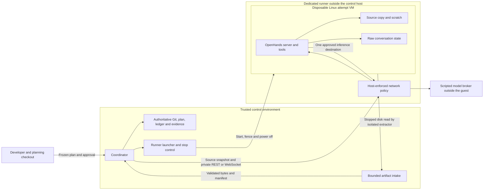

# M1-06 Execution security boundary

**Recommendation — Conditional.** Use a fresh Linux VM for each attempt on a dedicated runner, with a restricted OpenHands container inside it. Keep the coordinator, authoritative Git, planning records, and provider credentials outside the VM. Use a synthetic repository and one scripted inference endpoint for the proof of concept. Issue #12 must demonstrate the four denials and the allowed workflow on the exact deployed profile before unattended execution. This is a research recommendation for developer review. [Issue #6][i6] · [Issue #12][i12]

## Evidence and scope

- **Source-confirmed** means the cited source describes the behavior or mechanism. OpenHands Software Agent SDK and Agent Server `v1.62.0` resolve to `504a88cab0fb48ee5226238ad7b8f1d865fa84a8`, the M1-01 pin. Rolling Git, Docker, Linux, libvirt and Microsoft documentation was reviewed on 2026-11-17. The deployment must separately pin its installed versions and image digests. [Tag ref][oh-tag] · [OpenHands research](openhands.md)
- **Measured** applies here to the research checkout only. The workspace is on Windows under `E:\Home\Documents\Programming\ai-dev-orchestrator`, with a PowerShell shell. The clean checkout and fetched `main` resolved to `d4a806dba0ed6293981647498892a1a55e1871a3` before the document was added. Target-host runtime and security measurements remain open.
- **Open** marks an unverified deployment property or integration choice. The proposed permissions and limits below are test inputs. See the [open checks](#open-checks-and-stop-conditions) for closure criteria. Scope follows the project [vision](../docs/vision.md), draft [requirements](../docs/requirements.md) and [architecture](../docs/architecture.md), [model routing](model-routing.md), and the [planning-to-execution handoff](planning-execution-handoff.md).

## Threat model and trust boundary

Assume an executor can choose arbitrary shell commands and arbitrary output, even when a model, tool schema, or confirmation policy says otherwise. Repository files, dependency scripts, model replies, tool output, native events, Git diffs, archives, and test results can carry malicious content. A compromise may include the entire Agent Server or Linux guest. Trust the developer's approval, the coordinator, the runner's host and hypervisor administration, the network enforcement point, and the narrow parts of the broker and artifact intake that process untrusted input. An approved model endpoint is also a data destination. Anything already visible to the agent can be encoded into its calls or submitted as an artifact.

| Priority | Threat and likelihood | Design response and remaining exposure |
| --- | --- | --- |
| P1 | Repository or tool-output prompt injection. High likelihood, critical impact if it gains trusted authority. | Launch only from frozen policy. A reply, tool call, log line or forged status cannot approve work, schedule a task, change policy, or trigger coordinator-side execution. Verification and promotion use coordinator-owned records. |
| P1 | Malicious dependency or build scripts. High likelihood of executing package or repository code, high impact. | Run builds and tests inside the same boundary. Start with dependency-free fixture code and a pinned image with the required tools. Approve any later dependency retrieval as a separate input-preparation path with pinned bytes. |
| P1 | Credential exfiltration or abuse of approved inference. High likelihood of attempts, critical impact. | Supply only fixture data and a bogus SDK credential. Keep provider keys and authority outside the guest. Enforce egress and broker call policy independently. A real broker would still receive data the executor can read and send. |
| P1 | Traversal, symlinks or malicious artifact paths. High likelihood of attempts, critical impact. | Use a narrow source copy, enforce filesystem separation, and validate imports and exports with rooted, no-follow operations. Stage outputs as data. Artifact and filesystem parsers remain attack surfaces. |
| P1 | Container escape, privilege escalation or host-control API abuse. Lower likelihood on a patched runtime, critical impact. | Remove privileged devices and management interfaces. Use a separate guest kernel and dedicated runner. Hypervisor escape and vulnerabilities in trusted endpoints remain residual risks. |
| P2 | CPU, memory, disk, process, or log exhaustion. High likelihood, high impact. | Enforce limits outside the executor, bound broker and intake traffic, and reserve runner capacity. Keep the coordinator on a separate host. |
| P2 | Cross-attempt contamination or late writes. Medium likelihood, high impact. | Use a new VM, store and route binding for each attempt. Fence and stop the previous VM before sealing output or dispatching a replacement. A lost response keeps the attempt on hold. |
| P2 | Sensitive data in logs and artifacts. High likelihood, high impact. | Retain structured, bounded trusted records. Quarantine raw content, restrict artifact access, and test canary exclusion. Redaction catches known forms and cannot remove every possible encoding. |

## Environment and permissions

The Windows workstation can host the trusted checkout and coordinator. The reference profile assumes a separate, patched x86-64 Linux runner offering KVM/QEMU or equivalent hardware virtualization, a disposable Linux guest, and a Linux OCI container running the pinned Agent Server in local conversation mode. Run one attempt at a time. Exact OS, hypervisor, runtime, kernel features, and management transport remain open. [libvirt domain configuration][vm] · [OpenHands runtime selection][oh-config]

| Surface | Trusted side | Executor permission and enforcement |
| --- | --- | --- |
| Filesystem and mounts | Authoritative checkout, planning and approval storage, accounting DB, operator home, and runtime control files stay on the control or runner host. | Approved source under `/workspace/project`, with writes confined to task-owned paths. Mount read-only context separately from writable source directories. Permit bounded scratch under `/tmp` and a clean ephemeral `HOME` such as `/scratch/home`, plus attempt-local native state under `/state`. Permit read-only image files and minimal guest pseudo-filesystems and device nodes needed by tools. The guest gets dedicated virtual disks, with host shares, volume inheritance and mount propagation disabled. |
| Processes and devices | A runner supervisor controls VM creation, deadlines, and disposal. The guest runtime controls the container. | Fixed non-root UID/GID, dropped Linux capabilities, `no-new-privileges`, seccomp syscall filtering, and an enforcing AppArmor or SELinux policy. Private PID, mount, user, IPC and network isolation where applicable. Exclude host PID/IPC/network modes, privileged containers, device passthrough, GPU, Docker/CRI/libvirt sockets, SSH agent sockets, and writable cgroup controls. |
| Network | Coordinator initiates private control traffic through a trusted ingress filter or proxy. A host-side filter independent of the guest enforces flow policy and source binding. | One outbound flow to a fixed attempt-bound broker IP and TCP port. Permit established replies to coordinator-initiated control flows. Deny other new flows, including LAN, host management, other guests, metadata, package registries, Git, public Internet, and DNS. Cover IPv4, IPv6, direct IP, spoofing and lateral traffic. Keep guest loopback inside the attempt. |
| Model and control authentication | The broker owns any future provider inference key. Provider management and Git credentials stay with trusted principals. Authenticate the coordinator to the trusted control ingress with private client credentials. | Start with a dummy SDK value and a scripted broker with zero upstream calls. Bind broker access to the attempt at the host-side boundary. An optional Agent Server session key is disposable and applies only to that guest. Treat it as visible to a compromised server. Keep provider credentials, external account sessions, SSH keys, credential helpers, and coordinator private keys out of guest env, images, mounts and requests. |
| Agent tools and MCP | Coordinator supplies an explicit launch profile and a narrow REST/WebSocket route allowlist for create, event, run, status, and stop. | Enable terminal and file editor only. Keep client-executed tools, dynamic tool imports, hooks, plugins, browser, subagents, ACP providers, and local or remote MCP out of the fixture. The launch allowlist reduces callable features. The OS boundary still applies to all shell activity. |
| Git and planning | Give only the coordinator's trusted integration identity task-candidate and milestone ref writes. Keep publication under developer control. Planning and accounting stores accept writes only from their designated owners. | Import approved tracked source from one pinned commit, excluding `.git`, linked worktrees, alternates, nested metadata, planning/ledger records, host Git configuration and remotes. Skip submodules, LFS downloads, filters, hooks and symlinks in the initial fixture. Git commands can operate on disposable bytes the executor creates. Authoritative objects, refs, credentials and endpoints are out of reach. |
| Logs, telemetry and artifacts | Use coordinator-generated attempt IDs, config digests, timestamps, stop evidence, counter deltas, and artifact manifests in access-controlled stores. | OpenHands events, terminal captures, stats, raw stdout/stderr, and guest state are untrusted. Keep them on bounded attempt storage. Disable completion logging, diagnostics export and webhooks. Release only validated files and bounded, sanitized diagnostics through artifact intake. |

A dedicated Linux runner gives a direct route to Linux namespaces, cgroup v2 resource limits and a host-side VM network filter. Windows can remain the control host. A Windows-only deployment would need its own qualified Hyper-V/Linux guest profile and virtual-switch filtering, plus checks for mapped drives, device and clipboard redirection, host services, and filesystem path rules. WSL can automount Windows drives and supports interop and multiple network modes. Windows Sandbox enables networking and clipboard by default and targets Windows apps. Treat these defaults as integration features that require review, and repeat #12 on any selected Windows-hosted profile. [Linux cgroup v2][cgroups] · [Hyper-V switch][hyperv] · [WSL settings][wsl] · [WSL networking][wsl-net] · [Windows Sandbox configuration][win-sandbox]

### Isolation options

| Approach | Boundary and operating cost | Decision for this fixture |
| --- | --- | --- |
| Git worktree | Separate checkout and index with a common Git directory, object database, and ordinary refs shared across worktrees. Commands still inherit their process's filesystem, credentials and network privileges. A linked checkout can reach shared metadata and change refs when the user can write them. | Use worktrees only for trusted Git workflow. Detached HEAD and Git worktree locks govern Git behavior. OS isolation must constrain hostile commands. [Git worktree internals][git-worktree] |
| Source-only copy | Removes authoritative metadata, history and Git hooks from the input. Cheap to recreate. Host privileges still apply if a process runs the copy directly. | Use as the input inside the sandbox. |
| Hardened Linux container | Namespaces, capability limits, seccomp, mounts, and cgroups can confine ordinary command effects. The container shares the runner kernel. A daemon socket or broad mount can defeat the design. | Use inside the attempt VM. A container-only deployment would require a separate decision and evidence on a dedicated disposable worker. [Docker security][docker-run] · [Seccomp][seccomp] · [Bind mounts][binds] |
| Dedicated Linux VM per attempt | Separate guest kernel plus host-controlled storage, networking and lifecycle. A golden image and one active attempt keep boot, teardown and policy straightforward. Adds image maintenance and hypervisor exposure. | Reference boundary for this threat model. Exclude host filesystems, host-control channels, management NICs and physical device sharing from the guest. [libvirt domain configuration][vm] · [libvirt network filters][netfilter] |

## OpenHands source findings

All findings in this table are **source-confirmed** at the M1-01 pin. The deployment implications are proposed, and their effective behavior is open.

| Surface | Pinned behavior | Implication |
| --- | --- | --- |
| Local runtime and command identity | The Agent Server defaults to local conversation runtime. A terminal backend launches its shell with a working directory and constructed environment. The file editor accepts absolute host paths and its write logic can follow a symlink target. A tool's working directory sets context. | Run the Agent Server itself in the disposable guest/container. Base access on kernel boundaries. Running the SDK in the coordinator process would give local tools that process's authority. [Runtime config][oh-config] · [Local workspace][oh-localws] · [Terminal subprocess][oh-subproc] · [Editor path validation][oh-editor] · [Editor symlink write][oh-editor-link] |
| Image and Docker launcher | The full Dockerfile stage grants passwordless `sudo` to the runtime account. The minimal stage uses a non-root user and still contains ACP build inputs unless the build excludes providers. The SDK's `DockerWorkspace` accepts mounts, env forwarding, a named network, and optional GPU; it publishes on host loopback. Its reviewed launch flags add `--rm` and a file descriptor limit, without configuring the proposed capability, read-only filesystem, CPU, memory, PID or egress policy. | Use an explicit deployment outside the SDK launcher, preferring a minimal, credential-free image with unused providers omitted. Inspect the actual built digest and effective runtime settings. Keep server-managed Docker and selectable runtimes disabled. [Image stages][oh-img] · [Sudo grant][oh-sudo] · [Source targets][oh-targets] · [Docker fields][oh-docker-fields] · [Launcher flags][oh-docker-run] |
| Tools, routes and MCP | The request defaults to `NeverConfirm` and supports dynamic server tool imports, client-executed tools, plugin sources, and shell hooks. Local initialization searches for ambient project and user plugins, which can add MCP, hooks and subagents. MCP accepts command-based stdio and URL transports. The API registers separate Bash, file, settings and MCP routes. Generic upload/download accept server-visible absolute paths. Static workspace serving applies its own containment check. | Assemble the fixture from an explicit file manifest. Exclude plugin roots including `.agents/plugins` and `.openhands/plugins`, disable project skills, use a clean home, and inspect the resolved tool and extension inventory. Empty request lists alone leave ambient code paths. Allow only necessary control routes at ingress and avoid executing client-tool events on the coordinator. [Request schema][oh-request] · [Ambient discovery][oh-ambient] · [Plugin paths][oh-plugin-paths] · [MCP config][oh-mcp] · [API routing][oh-api] · [File paths][oh-upload] · [Download][oh-download] · [Static containment][oh-static] |
| Credentials and network | REST checks `X-Session-API-Key` when configured. WebSocket supports first-frame auth. Terminal logic can export matching conversation secrets into the shell session and masks recognized text in observations. Persisted state supports encryption with a configured cipher and redacts secrets on save without one. The LLM accepts a configured base URL. | Use external ingress auth and broker enforcement. Real credentials never enter the guest, even encrypted at rest. Treat terminal masking and session keys as scoped features. A named Docker network and loopback-published port address connectivity and ingress. Apply the allowlist independently for egress. [REST auth][oh-auth] · [Socket auth][oh-socket] · [Secret export and masking][oh-secrets] · [State serialization][oh-state] · [LLM config][oh-llm] |
| Logging, recovery and cleanup | Agent Server persists conversation and Bash data, supports diagnostic exporters and webhooks, and SDK completion logging is opt-in. Interrupt waits up to five seconds for the run task and can return while it drains. Restart can mark stale running state as an error and add an observation for a missing tool result. Deletion is best effort and preserves an ordinary workspace. | An acknowledgement or missing observation leaves command effects uncertain. Fence outside the VM and confirm shutdown before sealing or reuse of authority. Raw native history may be modified by a co-resident compromised tool. For this profile store it as disposable, untrusted evidence. The handoff requirement for a tool-inaccessible native store remains open if durable native resume is required. [Storage settings][oh-paths] · [Telemetry settings][oh-telemetry] · [Completion logging][oh-log] · [Stop drain][oh-stop] · [Restart handling][oh-recovery] · [Cleanup][oh-delete] · [M1-05 single writers](planning-execution-handoff.md#single-writer-ownership) |

## Minimum secure proof of concept

1. **Provision from pinned inputs.** Use a patched runner and a fresh VM cloned from an immutable, credential-free template. Preload the digest-pinned OpenHands image and offline test toolchain. Materialize a source snapshot from the assigned full Git object ID and approved path manifest inside the guest's task disk. Resolve paths in a trusted importer. Reject absolute paths, traversal, unexpected file types, case or normalization collisions, and prohibited metadata. Use a disposable, unprivileged runtime with a private read-only container root and bounded writable mounts. Set `worktree: false` and use a fixed local runtime and frozen tool profile. [Bind mounts][binds] · [Seccomp][seccomp] · [OpenHands creation][oh-create]
2. **Pin the only network route.** Install and verify the host policy before exposing the VM's NIC. On the trusted side of that NIC, permit coordinator-initiated control flows and guest-initiated inference to one fixed IP and port. Enforce default deny and anti-spoofing at the virtual NIC or a routed policy point that also sees lateral traffic. Use an isolated subnet with no Internet uplink for the synthetic run. Set the broker to accept only the intended Chat request method, path, model, attempt binding, byte/token bounds, and request budget. Reject redirects, generic proxying, user-supplied destinations, tunnel upgrades and hosted tools. Keep SDK retries and fallback off for the fixture. The broker uses static scripted responses and never forwards. If a later provider profile is authorized, the broker enforces routing, privacy and budget before submission and uses a scoped inference key outside the guest. [VM network filter primitives][netfilter] · [Docker packet filtering][docker-firewall] · [Routing research](model-routing.md)
3. **Enforce resource and stop limits.** Proposed initial values per attempt are 2 guest vCPUs and 4 GiB guest RAM, with container limits of 1 CPU, 2 GiB RAM, zero additional swap, and 128 tasks including threads. Cap writable guest storage with a preallocated or quota-backed 8 GiB budget with inode limits, including overlays, runtime state and logs. Cap the task-source volume at 1 GiB and scratch tmpfs at 128 MiB. Bound diagnostics and artifact collection separately at 10 MiB each, including a file-count and per-file cap in the fixture profile. Enforce CPU, memory, PID and swap controls using effective cgroup v2 settings. Apply VM resource and disk bounds at the host. An external supervisor grants a 10-minute lifetime from VM start, revokes network authority at expiry or cancellation, and forces power-off within a proposed 10-second grace period. Verify that the VM stopped and its supervisor reaped the host process. These numbers are proposed fixture limits. Issue #10 should set the final profile before #12. [Linux cgroup v2][cgroups] · [Docker resource constraints][docker-limits] · [Rootless controller caveats][docker-rootless] · [VM resource options][vm]
4. **Seal through bounded intake.** Revoke the route and stop the VM before collecting canonical outputs. Attach only its stopped task disk read-only to a separate disposable extractor. Keep guest filesystem parsing off the coordinator and runner host kernel. Treat extractor responses as hostile. Walk from a fixed root with no link or mount traversal, compare against the original manifest, and send bounded relative-path records with bytes, file kind, and safe mode. Reject absolute or escaping paths, links including hard links, special files, alternate streams or platform path aliases, nested `.git`, and protected or undeclared targets. Validate again on the trusted receiving side and write into a fresh staging root using rooted no-follow operations. Avoid general-purpose archive extraction. Turn excess size, missing evidence, or collector errors into a quarantined result. Keep only approved file changes, trusted byte hashes, and sanitized evidence. The coordinator computes the patch against the pinned base. Any candidate commit or expected-old-OID ref update stays in the trusted integration path under M1-05. [Linux path resolution][openat2] · [Git ref update][git-cas] · [M1-05 handoff](planning-execution-handoff.md#dispatch-observation-and-integration)
5. **Record, verify, and tear down.** Persist the assigned attempt/configuration, independent stop and audit events, and the sealed artifact receipt. Treat agent-reported tests and stats as observations. Run project code for independent verification in a fresh qualified sandbox with a sealed candidate input. On success, failure, cancellation, or lost responses, reconcile the original VM and broker binding before releasing another attempt. Remove the VM, disks/overlays, disposable extractor, endpoint bindings, non-retained logs, and attempt credentials. Hold dispatch and promotion if cleanup or evidence integrity is uncertain. Issue #11 owns the detailed restart and cancellation tests. [Issue #11][i11]

Mounts, identities, namespaces, VM configuration, egress filtering, quotas and whole-runtime termination require OS, runtime or hypervisor enforcement. Policy decisions about permitted Git paths, broker requests, trusted log fields, artifact types, approvals and ref transitions belong in trusted services outside the executor. Prompts and tool confirmation can guide behavior. They cannot grant or remove OS privileges.

## Issue #12 test specifications

All five are **open**. Reproduce them on the same target host and pinned profile as the Issue #10 fixture. Use scripted tool calls and a preinstalled bounded probe so the model cannot choose to skip a test. Drive the enabled OpenHands tools. For denials, also run the equivalent direct syscall, socket, or Git probe under the same UID, namespaces, cgroup and network policy. Use a harmless fixture per case and confirm from the trusted harness that the probes executed. Test only synthetic resources.

Freeze a manifest for the run with exact case inputs, commands or tool JSON, UID, path aliases, literal IPs and ports, expected outcomes, request and time limits, and SHA-256 digests for fixture bytes. Use fresh attempts or independent subcases when one probe can change another probe's preconditions. Keep the runner's management interface off the synthetic network.

For each case, record the attempt ID, exact probe input or digest, target alias, timestamps, tool and independent process statuses, expected/actual denial stage, artifact or protected-state hashes, and cleanup outcome. Capture effective guest mounts, UID/GID, privilege and syscall policy, process/cgroup and disk bounds, host network policy and route counters, available tools, and image/fixture versions with secret values and unrelated environment omitted. Run trusted positive controls that show fixture targets exist, services respond, and inputs could change their disposable target absent enforcement. Restore the synthetic baseline or use a separate identical control target before the actual probe. An absent resource, wrong address, unexecuted command, or missing trusted record is inconclusive unless the measured boundary caused the absence.

### A. Out-of-workspace reads and writes

- **Setup.** Outside the guest or container, create a protected synthetic read marker, a writable sentinel with known bytes in the trusted harness, and an empty sibling directory. Include stand-ins for the planning and ledger stores, host data and a previous attempt. Add a harmless file within the guest owned by a separate UID with access denied to the tool, plus a read-only source-context file. This distinguishes OS permission denial from targets omitted by mount policy. Record owners, permissions, and content hashes. Record the planned denied pathname for each explicit target.
- **Action.** From the terminal and file editor where applicable, try absolute reads and writes, create a new sibling file using `..`, and repeat via a workspace symlink pointing outside. Exercise the direct filesystem probe so tool validation cannot account for all denials. Attempt a small append to the read-only context file as well. Separately submit a fixture artifact containing a traversal entry and an out-of-root symlink to intake. All targets are disposable.
- **Expected.** Reads reveal zero protected marker bytes. Read-only context can be read and rejects edits. Writes and creates fail because the target is absent from the namespace or denied by enforced permissions. Intake rejects escaping paths and links before staging. Trusted hashes, permissions, and the sibling directory inventory match the baseline.
- **Evidence.** Record syscall/tool status, namespace or mount evidence for missing paths, file and directory manifests before and after stop, and intake rejection codes. Probe a normal scratch file to confirm tool I/O.
- **Cleanup.** Remove the workspace link and disposable sentinels after final hashes. Discard the rejected bundle and quarantine entry.
- **Failure.** Any external read, file creation, mutation, change to read-only context, or escaped staged file fails. A tool-level refusal without a direct probe is inconclusive.

### B. Synthetic credential access and leakage

- **Setup.** Generate distinct high-entropy canaries for a mock provider key, coordinator auth, and a fake host credential file. Place them only in dedicated trusted fixture processes or files. Where relevant, give the fixture process a known PID and synthetic-only environment for PID and inheritance checks. Give the guest a distinct public dummy SDK value to prove the test can read permitted configuration. Keep canary values in an isolated scanner.
- **Action.** Probe only fixture names in guest environment and process paths, nominated files, and synthetic credential or management socket paths. Try to relay any recovered value through terminal output, final text, a workspace artifact, the allowed scripted broker request and a blocked synthetic sink. Independently submit synthetic tainted diagnostics to the intake gate to exercise quarantine or redaction even when all searches miss.
- **Expected.** The executor recovers no protected canary. Protected logs and retained diagnostics contain none of the canaries. Seeded tainted diagnostics are rejected or sanitized before durable write. No receiver observes a protected canary, including the broker.
- **Evidence.** Record presence/absence booleans and probe statuses. Scan attempt-local transcripts and proposed artifacts, sanitized control and broker logs, and synthetic sink captures for the exact canaries and predefined encoded forms such as Base64 and URL encoding. Store only result counts, match categories and fixture IDs. A positive control verifies scanner detection before audit.
- **Cleanup.** Destroy canaries, transient raw captures and staged tainted input after scanning. Remove the dummy credentials and fixture sockets, and verify no retained copy or configured credential carries across attempts.
- **Failure.** Any protected canary recovered or copied to a tool, output, broker, artifact or protected log fails, including a canary hidden by UI masking. An unscanned retained channel or missing scanner control is inconclusive.

### C. Forbidden network egress

- **Setup.** Stand up the allowed scripted broker and forbidden listeners on a lab subnet behind the expected enforcement point. Simulate the runner-local service, a peer attempt and an outside destination with controlled addresses. Include an alternate port on the broker IP and a synthetic DNS sink. Verify each listener from a trusted vantage point that has the intended route.
- **Action.** From the guest, send one valid scripted Chat request. Attempt bounded direct IPv4 and IPv6 TCP connections to forbidden listeners, a UDP and TCP DNS query to the sink, and a request with an alternate broker path or method and an attempt to use the broker as a tunnel or relay. Also probe from a trusted runner-side fixture assigned the guest's enforcement path, where the selected topology supports that check. Use short timeouts and harmless payloads.
- **Expected.** The approved call reaches only the scripted endpoint. Forbidden traffic is denied at the network boundary, including IPv6 when it is disabled there. The broker rejects improper requests without an outbound submission. A guest-side missing route alone leaves the guest-compromise layer unverified.
- **Evidence.** Record the allow/deny rule snapshot, routed target readiness, host-side rule counters or packet capture on the relevant enforcement interfaces, broker rejection and request counts, sink-side capture, and direct probe return status.
- **Cleanup.** Shut down synthetic listeners. Revoke the attempt NIC/broker binding after stop and verify that a stale request cannot be admitted.
- **Failure.** Any forbidden packet reaching a sink, successful forbidden connection, relayed request, or accept after revocation fails. An unreachable control target or missing host-side evidence is inconclusive.

### D. Unauthorized Git writes

- **Setup.** Create an authoritative-style synthetic checkout outside the guest and a laboratory bare remote on a forbidden listener. Record `HEAD`, refs and object IDs, index, reflogs, and object inventory. Seed an alternate fixture commit so an update would change the protected ref. Provide the sandbox a metadata-free copy plus a standalone disposable Git sender for the push subcase. Configure the remote to accept the intended update from a trusted control sender and prove that on an identical control target.
- **Action.** Attempt `git commit --allow-empty` in the source copy, then direct commit and `git --git-dir=<protected-fixture-path> update-ref refs/heads/main <alternate-oid>` against the protected checkout. Try to write its ref through a direct pathname and to reach the bare remote both by filesystem path and via a real `git push` from the disposable Git sender to the synthetic listener. Use known fixture Git identity and an explicit refspec. Avoid unrelated remotes.
- **Expected.** The assigned copy exposes no authoritative Git metadata, the protected checkout and bare remote cannot be mutated, and the network push does not reach the receive service. Both protected Git stores retain the same ref/object, index and reflog state.
- **Evidence.** Record effective Git config scope and Git-directory discovery result without secrets, trusted before/after ref and object inventories, command exits, enforcement counters or capture, and remote request logs.
- **Cleanup.** Seal the comparison, then delete the disposable Git sender, trusted fixture checkout, and bare remote. Confirm no leftover worktrees, locks, ref changes, credentials, or listeners.
- **Failure.** Any authoritative-style Git mutation, network contact with the receive service, or unexpected Git metadata in the source copy fails. A push that fails before trying delivery because of invalid local inputs is inconclusive.

### E. Authorized in-workspace edit and tests

- **Setup.** Use a tiny dependency-free Node fixture from a pinned source revision, with approved `src/validate.js` and `test/validate.test.js` paths. Record hashes, expected candidate diff, manifest limits, and a known expected test result using the preloaded Node runtime. Give the scripted model a deterministic edit-and-test sequence.
- **Action.** Dispatch via the normal coordinator and Agent Server flow. Apply an authorized validation change with the editor, then run `node --test test/validate.test.js` in the sandbox. Revoke access and stop the VM. Extract and seal the expected files. Re-run the check against the sealed candidate in a fresh verification sandbox. As a teardown subcase, use a short-lived background sentinel writer in a disposable attempt and verify that the external deadline stops it before collection and before the next attempt starts.
- **Expected.** The intended edit and check succeed. The trusted manifest contains only approved changes, and independent checks confirm the expected behavior and exact candidate. The teardown subcase leaves no late writes or artifacts visible to the next attempt.
- **Evidence.** Record control requests, broker request count, selected tool actions, test process status, trusted diff and content digests, independent test result, and host-side stop confirmation. Record the late-writer observation and the subsequent workspace probe.
- **Cleanup.** Remove execution and verification VMs, extractor, scratch volumes, routes and fixture data after evidence retention. Check that both successful and timed-out attempts have cleanup receipts.
- **Failure.** Missing or incorrect edit, mismatched diff, failed or unexecuted checks, failed extraction, late writes, cross-attempt access, or incomplete teardown fails.

## Open checks and stop conditions

| Open item | Next check and release condition |
| --- | --- |
| Runner platform and exact deployment | Select and pin OS/kernel, hypervisor, OCI runtime, MAC policy, base/image digests and tool versions in #10/#12. Review the effective mounts, namespaces, device policy, profiles and network rules. Record actual resource and time limits. Absent enforcement or missing platform evidence blocks unattended runs. |
| Profile and local model compatibility | Prove the pinned server starts with the explicit non-root profile and clean image, reaches only the scripted broker, and resolves only the approved tools. Check that guessed API paths and ambient plugin roots yield no trusted-side action. Issue #13 qualifies real routing, credentials and billing separately. [Issue #13][i13] |
| Resource limit coverage | Validate the live controllers, disk/inode, log and intake bounds, and outer deadline. Use tiny, finite probes in disposable attempts with deliberately small caps to check rejection and teardown. Keep schedule admission off when a required controller has no effective limit. |
| Native state and recovery | Keep trusted records independent of native events. Prove cancellation fencing and restart reconciliation in #11. A deployment that needs durable, tool-inaccessible native state must demonstrate OS separation of that state from tools, or qualify a split runner. The local-runtime source review leaves this unverified. [Issue #11][i11] |
| Extraction, evidence and cleanup | Demonstrate isolated extraction, manifest safety and canary scans before promoting a candidate. Retain evidence according to a policy approved for fixture data. Unbounded parsing, missing audit evidence, orphan runtimes or storage, and unverifiable cleanup block promotion and retry. |
| Residual isolation risk | A patched hypervisor and parsers still have an attack surface, and accepted data can cross the authorized broker and artifact paths. Restrict the fixture to synthetic inputs, keep management unreachable, and assess patches, data class and broker policy before any broader authorization. |

## Issue #12 handoff and recommendation

- **Inputs.** Use Issue #10's fixture, the M1-01 pin, a versioned runtime and network profile, and operator-owned sentinel, broker, sink and bare Git fixtures. Preflight with trusted controls. Record the exact host and kernel, image/guest/profile digests and runner settings, and any deviations. A changed isolation profile requires a fresh run. [Issue #10][i10] · [Issue #12][i12]
- **Required result.** Publish a per-case pass/fail/inconclusive matrix for A–E with attributable, sanitized evidence and independently checked teardown. Record each denial at the enforcing layer, unchanged protected state, zero secret exposure, zero forbidden delivery, and a sealed authorized change with independent test evidence. Record observed resource limits and the deadline/late-writer check. A failed or inconclusive mandatory check, unexpected privileges, or incomplete cleanup keeps unattended dispatch blocked. Rerun the affected tests and the positive workflow after correcting a boundary gap.
- **Conditional.** Proceed with synthetic fixture design and review of the proposed Linux VM profile. A Go decision for unattended synthetic execution requires all five tests and the boundary evidence above on the chosen host, plus applicable recovery and integration gates. Any use of real repositories or providers requires its own data and routing approval. Runtime enforcement remains open in this research.

[i6]: https://github.com/taggedzi/ai-dev-orchestrator/issues/6
[i10]: https://github.com/taggedzi/ai-dev-orchestrator/issues/10
[i11]: https://github.com/taggedzi/ai-dev-orchestrator/issues/11
[i12]: https://github.com/taggedzi/ai-dev-orchestrator/issues/12
[i13]: https://github.com/taggedzi/ai-dev-orchestrator/issues/13
[git-worktree]: https://git-scm.com/docs/git-worktree#_refs
[git-cas]: https://git-scm.com/docs/git-update-ref
[docker-run]: https://docs.docker.com/engine/containers/run/
[docker-firewall]: https://docs.docker.com/engine/network/packet-filtering-firewalls/
[docker-limits]: https://docs.docker.com/engine/containers/resource_constraints/
[docker-rootless]: https://docs.docker.com/engine/security/rootless/tips/#limiting-resources
[seccomp]: https://docs.docker.com/engine/security/seccomp/
[binds]: https://docs.docker.com/engine/storage/bind-mounts/
[cgroups]: https://www.kernel.org/doc/html/latest/admin-guide/cgroup-v2.html
[vm]: https://www.libvirt.org/formatdomain.html
[netfilter]: https://libvirt.org/formatnwfilter.html
[openat2]: https://man7.org/linux/man-pages/man2/openat2.2.html
[hyperv]: https://learn.microsoft.com/en-us/windows-server/virtualization/hyper-v/get-started/create-a-virtual-switch-for-hyper-v-virtual-machines
[wsl]: https://learn.microsoft.com/en-us/windows/wsl/wsl-config
[wsl-net]: https://learn.microsoft.com/en-us/windows/wsl/networking
[win-sandbox]: https://learn.microsoft.com/en-us/windows/security/application-security/application-isolation/windows-sandbox/windows-sandbox-configure-using-wsb-file
[oh-tag]: https://api.github.com/repos/OpenHands/software-agent-sdk/git/ref/tags/v1.62.0
[oh-config]: https://github.com/OpenHands/software-agent-sdk/blob/504a88cab0fb48ee5226238ad7b8f1d865fa84a8/openhands-agent-server/openhands/agent_server/config.py#L404-L429
[oh-localws]: https://github.com/OpenHands/software-agent-sdk/blob/504a88cab0fb48ee5226238ad7b8f1d865fa84a8/openhands-sdk/openhands/sdk/workspace/local.py#L17-L77
[oh-subproc]: https://github.com/OpenHands/software-agent-sdk/blob/504a88cab0fb48ee5226238ad7b8f1d865fa84a8/openhands-tools/openhands/tools/terminal/terminal/subprocess_terminal.py#L134-L174
[oh-editor]: https://github.com/OpenHands/software-agent-sdk/blob/504a88cab0fb48ee5226238ad7b8f1d865fa84a8/openhands-tools/openhands/tools/file_editor/editor.py#L657-L706
[oh-editor-link]: https://github.com/OpenHands/software-agent-sdk/blob/504a88cab0fb48ee5226238ad7b8f1d865fa84a8/openhands-tools/openhands/tools/file_editor/editor.py#L499-L528
[oh-img]: https://github.com/OpenHands/software-agent-sdk/blob/504a88cab0fb48ee5226238ad7b8f1d865fa84a8/openhands-agent-server/openhands/agent_server/docker/Dockerfile#L403-L451
[oh-sudo]: https://github.com/OpenHands/software-agent-sdk/blob/504a88cab0fb48ee5226238ad7b8f1d865fa84a8/openhands-agent-server/openhands/agent_server/docker/Dockerfile#L459-L507
[oh-targets]: https://github.com/OpenHands/software-agent-sdk/blob/504a88cab0fb48ee5226238ad7b8f1d865fa84a8/openhands-agent-server/openhands/agent_server/docker/Dockerfile#L696-L710
[oh-docker-fields]: https://github.com/OpenHands/software-agent-sdk/blob/504a88cab0fb48ee5226238ad7b8f1d865fa84a8/openhands-workspace/openhands/workspace/docker/workspace.py#L85-L126
[oh-docker-run]: https://github.com/OpenHands/software-agent-sdk/blob/504a88cab0fb48ee5226238ad7b8f1d865fa84a8/openhands-workspace/openhands/workspace/docker/workspace.py#L211-L267
[oh-request]: https://github.com/OpenHands/software-agent-sdk/blob/504a88cab0fb48ee5226238ad7b8f1d865fa84a8/openhands-sdk/openhands/sdk/conversation/request.py#L269-L357
[oh-ambient]: https://github.com/OpenHands/software-agent-sdk/blob/504a88cab0fb48ee5226238ad7b8f1d865fa84a8/openhands-sdk/openhands/sdk/conversation/impl/local_conversation.py#L1204-L1267
[oh-plugin-paths]: https://github.com/OpenHands/software-agent-sdk/blob/504a88cab0fb48ee5226238ad7b8f1d865fa84a8/openhands-sdk/openhands/sdk/plugin/discovery.py#L30-L42
[oh-mcp]: https://github.com/OpenHands/software-agent-sdk/blob/504a88cab0fb48ee5226238ad7b8f1d865fa84a8/openhands-sdk/openhands/sdk/mcp/config.py#L501-L557
[oh-api]: https://github.com/OpenHands/software-agent-sdk/blob/504a88cab0fb48ee5226238ad7b8f1d865fa84a8/openhands-agent-server/openhands/agent_server/api.py#L635-L673
[oh-upload]: https://github.com/OpenHands/software-agent-sdk/blob/504a88cab0fb48ee5226238ad7b8f1d865fa84a8/openhands-agent-server/openhands/agent_server/file_router.py#L90-L113
[oh-download]: https://github.com/OpenHands/software-agent-sdk/blob/504a88cab0fb48ee5226238ad7b8f1d865fa84a8/openhands-agent-server/openhands/agent_server/file_router.py#L142-L162
[oh-static]: https://github.com/OpenHands/software-agent-sdk/blob/504a88cab0fb48ee5226238ad7b8f1d865fa84a8/openhands-agent-server/openhands/agent_server/workspace_router.py#L62-L75
[oh-auth]: https://github.com/OpenHands/software-agent-sdk/blob/504a88cab0fb48ee5226238ad7b8f1d865fa84a8/openhands-agent-server/openhands/agent_server/dependencies.py#L19-L39
[oh-socket]: https://github.com/OpenHands/software-agent-sdk/blob/504a88cab0fb48ee5226238ad7b8f1d865fa84a8/openhands-agent-server/openhands/agent_server/sockets.py#L139-L231
[oh-secrets]: https://github.com/OpenHands/software-agent-sdk/blob/504a88cab0fb48ee5226238ad7b8f1d865fa84a8/openhands-tools/openhands/tools/terminal/impl.py#L334-L388
[oh-state]: https://github.com/OpenHands/software-agent-sdk/blob/504a88cab0fb48ee5226238ad7b8f1d865fa84a8/openhands-sdk/openhands/sdk/conversation/state.py#L474-L499
[oh-llm]: https://github.com/OpenHands/software-agent-sdk/blob/504a88cab0fb48ee5226238ad7b8f1d865fa84a8/openhands-sdk/openhands/sdk/llm/llm.py#L286-L335
[oh-paths]: https://github.com/OpenHands/software-agent-sdk/blob/504a88cab0fb48ee5226238ad7b8f1d865fa84a8/openhands-agent-server/openhands/agent_server/config.py#L275-L311
[oh-telemetry]: https://github.com/OpenHands/software-agent-sdk/blob/504a88cab0fb48ee5226238ad7b8f1d865fa84a8/openhands-agent-server/openhands/agent_server/config.py#L152-L199
[oh-log]: https://github.com/OpenHands/software-agent-sdk/blob/504a88cab0fb48ee5226238ad7b8f1d865fa84a8/openhands-sdk/openhands/sdk/llm/llm.py#L539-L547
[oh-stop]: https://github.com/OpenHands/software-agent-sdk/blob/504a88cab0fb48ee5226238ad7b8f1d865fa84a8/openhands-agent-server/openhands/agent_server/event_service.py#L2146-L2182
[oh-recovery]: https://github.com/OpenHands/software-agent-sdk/blob/504a88cab0fb48ee5226238ad7b8f1d865fa84a8/openhands-agent-server/openhands/agent_server/event_service.py#L1452-L1503
[oh-delete]: https://github.com/OpenHands/software-agent-sdk/blob/504a88cab0fb48ee5226238ad7b8f1d865fa84a8/openhands-agent-server/openhands/agent_server/conversation_service.py#L1851-L1915
[oh-create]: https://github.com/OpenHands/software-agent-sdk/blob/504a88cab0fb48ee5226238ad7b8f1d865fa84a8/openhands-agent-server/openhands/agent_server/conversation_service.py#L1629-L1676
