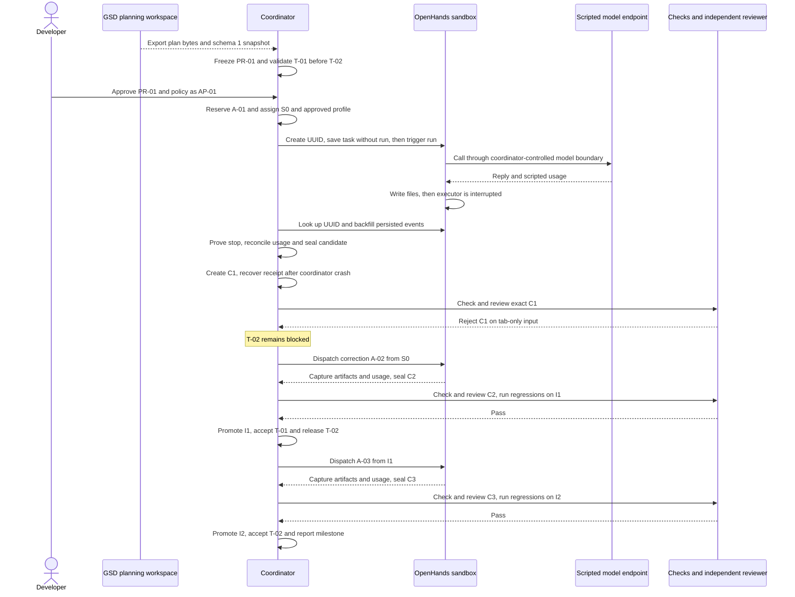

# M1-05 Planning-to-execution handoff

**Recommendation: Conditional.** Evaluate a one-way GSD Core import and a coordinator-controlled OpenHands adapter with a synthetic fixture. The developer authorizes scope and exceptions. The coordinator records those decisions and owns scheduling, attempts, verification, integration, and cost accounting. A dependent task starts from its predecessor's accepted integration commit. [Issue #5][i5] · [Vision](../docs/vision.md) · [Draft architecture](../docs/architecture.md)

## Evidence and scope

| Component | Source baseline |
| --- | --- |
| GSD Core, M1-02 | v1.21.0, commit `357508df233ccca0dcf4332b385d6bee9b113da9`, planning snapshot schema 1. [Pinned CLI][gsd-cli] · [GSD research](gsd-core.md) |
| OpenHands, M1-01 | SDK and Agent Server v1.62.0, commit `504a88cab0fb48ee5226238ad7b8f1d865fa84a8`. Candidate deployment is the default local conversation runtime in a dedicated self-hosted Linux sandbox. [Pinned request][oh-request] · [Executor research](openhands.md) |
| Model transport and policy, M1-03 and M1-04 | LiteLLM 1.105.1 from the OpenHands lock. OpenRouter Chat and generation lookup use the 2026-11-16 US Eastern review baseline. The fixture uses a scripted local Chat endpoint and deterministic selection with a fixed-profile control. Switchyard v0.3.0 (`336196f`), Ollama v0.40.16, and LM Studio REST v1 remain M1-04 comparison references. [SDK lock][oh-lock] · [Chat API][or-chat] · [Generation API][or-gen] · [Routing research](model-routing.md) |

**Source-confirmed.** GSD provides a versioned, read-only snapshot with diagnostics. It projects plans, dependencies and task criteria. Complete actions and check instructions require the raw PLAN files. Native execution can write Git commits and summaries. [Snapshot contract][gsd-cli] · [Task projection][gsd-tasks] · [PLAN grammar][gsd-plan] · [Native executor][gsd-exec]

**Source-confirmed.** OpenHands accepts a caller-supplied conversation UUID, a server-visible workspace, and agent configuration. It supports separate message and run calls, lookup, and event history. Creation can reuse a UUID. A conversation can run more than once, and the reviewed message and run routes expose no per-operation idempotency key. An interrupt acknowledgement can precede tool shutdown. Restart recovery can report an unmatched tool action as errored after it had an effect. [Create request][oh-request] · [Reuse][oh-create] · [Messages][oh-message] · [Run route][oh-run] · [Lookup][oh-lookup] · [Events][oh-events] · [Interrupt drain][oh-stop] · [Restart recovery][oh-restart]

**Source-confirmed.** OpenRouter exposes a Chat generation ID and usage lookup. LiteLLM's pinned adapter normalizes streaming chunks and can drop routing metadata. OpenHands stats aggregate usage and cost. Early ID capture, per-call attribution, and enforcement across the selected executor deployment remain **open**. [Generation API][or-gen] · [LiteLLM adapter][lit] · [Conversation stats][oh-stats] · [Routing boundary](model-routing.md#openhands-executor-boundary)

**Proposed.** The contract and trace below describe design choices. The identifiers, revisions, outcomes, and usage are fictional. **Measured runtime evidence:** none. The [fixture gates](#evaluation-and-fixture-gates) specify what to measure.

## Proposed contract

### Import and approval

1. Export a committed GSD bundle from a dedicated planning checkout. Resolve project context and run `gsd-tools query planning inspect` against an immutable copy. Freeze the source repo and commit, included paths and byte hashes, GSD pin, schema, importer version, and canonical bundle digest. Retain the snapshot and raw PLAN/context files. Record the execution repository and baseline commit separately.
2. Normalize one autonomous task per plan for the fixture. Preserve actions, allowed paths, criteria, done conditions, approved check definitions, relevant phase criteria, and edges. Validate schema and import diagnostics, unique scoped IDs, complete dependency resolution and acyclicity. Reject ambiguous aliases, missing context, unsupported tracker overrides, and criteria without observable evidence. Translate plan-authored commands into approved check definitions.
3. Present the frozen plan, normalized tasks, checks, baseline commit, and policy limits to the developer. Record authenticated approver, time, decision, digest and policy under an approval reference. Recheck authority, graph and predecessor acceptance before admission. Changes to approved intent require a new revision and approval.

### Dispatch, observation, and integration

- **Admission.** Atomically claim the ready task, reserve the attempt slot and budget, and persist the attempt ID, preassigned conversation UUID, approved task and prompt digest, expected input commit, runtime identity, workspace, permissions, profile revision, and deadlines. Recheck current approval and pause state before dispatch. Filter approved profiles by data class, destination, capabilities, context, and cost. Record the decision rule, requested model/provider/effort and config digest, and resolved values when reported. The fixture pins one route, sets `num_retries: 0` and leaves fallback unset. Qualify this across implementation and auxiliary calls. [Agent configuration][oh-agent] · [SDK retry policy][oh-retry] · [Routing research](model-routing.md)
- **Dispatch.** Provision an isolated source copy at the assigned commit, with no Git metadata, shared planning directory, remote credentials or writable main checkout. Protect the persisted conversation volume from agent tools. Restrict mounts, tools and egress. Create the conversation with the chosen UUID, exact workspace, agent config, `worktree: false` and no `initial_message`. Validate the binding, then save the translated task via `POST C/events` with `run: false` and separately trigger `POST C/run`, where `C = /api/conversations/{uuid}`. Persist intent and observations separately for each external call. [Create request][oh-request] · [Messages][oh-message] · [Run route][oh-run] · [Git worktree metadata][git-worktree]
- **Receipt.** Collect status, event IDs, final text, changed and untracked files, declared artifacts, test/tool output and usage snapshots. Backfill persisted events and deduplicate by deployment, conversation UUID and event ID. Verify tool quiescence or stop the dedicated sandbox before sealing output. Validate paths, links, permitted file changes, base and content hashes. Create the candidate commit in a trusted checkout. Record an immutable receipt keyed by attempt with input/output commits, artifact hashes, termination reason and usage links. Quarantine conflicting receipts. Retain evidence before cleanup. [Events][oh-events] · [File export][oh-files] · [Completion handling][oh-finish]
- **Usage.** Admit each inference call at a coordinator-controlled boundary that enforces destination and caps and records a new submission ID with a budget reservation. Include implementation, compaction and review. Require complete, policy-compliant responses before tool actions. Capture distinct request, generation and normalized response IDs with provenance. Deduplicate charges by gateway/account and generation where available. Keep reported, estimated, pending and unknown amounts distinct and include failed attempts and review. Use executor aggregates as diagnostic evidence. [Generation API][or-gen] · [Usage accounting][or-usage] · [Conversation stats][oh-stats] · [Spending limits][i9]
- **Verification and release.** Run mandatory checks on the sealed candidate SHA. An independent reviewer uses that SHA, its diff, frozen task and rubric, and check evidence. Record both verdicts with exact revision and versioned check/rubric/environment identifiers. After a pass, stage integration against the expected milestone head. Rerun regressions on the exact proposed integrated commit. Obtain fresh applicable checks and review if integration changes reviewed content. Serialize the approval and pause check with promotion, and advance the milestone ref with an expected-old-OID check. Block dispatch during unresolved promotion. Record acceptance durably before releasing the dependent task from that commit. [Draft requirements](../docs/requirements.md) · [Issue #8][i8] · [Git ref update][git-cas]

## Synthetic milestone and sequence

**Milestone M-CLI1, revision PR-01, approval AP-01.** Implement name validation in a small Node CLI. Both GSD plans are in phase `01-validate-cli`. Native waves provide provenance. The coordinator schedules from the validated edge.

| GSD source | Coordinator task | Acceptance criteria and checks |
| --- | --- | --- |
| `01-01-PLAN.md`, task 1, wave 1 | `T-01`, no dependencies | Add `src/validate.js` and `test/validate.test.js`. Keep valid names and reject empty or whitespace-only names, including tabs. Run `node --test test/validate.test.js` and the fixture grader's whitespace cases. |
| `01-02-PLAN.md`, task 1, wave 2, `depends_on: ["01-01"]` | `T-02`, requires accepted T-01 | Add `src/cli.js` and `test/cli.test.js`. Use the validator. Valid input exits 0. Blank input exits 2 with an error on stderr. Run `node --test test/cli.test.js` and the fixture grader's subprocess checks. |

S0 is the execution baseline. C1 is rejected. C2 is a fresh correction from S0 and is promoted as I1. T-02 starts at I1 and C3 is promoted as I2. Both promotions can fast-forward to the verified candidate SHA. Store full object IDs and repository identity.



The first executor dies after writing the validator and tests and before the final tool observation. A-01 enters `unknown_outcome`. The coordinator confirms stop, inspects events and files, and reconciles usage with the scripted endpoint's log. Fixture policy permits salvaging the sealed files. The coordinator records sealing intent, creates C1, then crashes before writing its receipt. Recovery checks the attempt ref, expected parent and tree digest against the sealing intent and artifact manifest. It records the receipt once without a second run. Independent checks and review reject C1 because tab-only names pass. AP-01 permits one same-scope correction under the fixture limits. A-02 starts with a new UUID, a clean S0 copy, and the defect evidence. T-02 stays blocked until I1 passes regression checks and is durably accepted. The milestone report includes all three attempts, checks, review, regressions, interventions, and usage with provenance.

### Example records

Symbolic revisions and hashes stand in for full identifiers. The model usage is scripted.

```yaml
approval:
  id: AP-01
  approver: fixture-developer
  approved_at: "2026-11-17T16:00:00Z"
  plan_revision: PR-01
  bundle_digest: "sha256:<frozen-bundle>"
  policy_revision: fixture-policy-v1

task:
  milestone_id: M-CLI1
  plan_id: P-02
  source_plan: "01-validate-cli/01-02-PLAN.md"
  source_task_position: 1
  task_id: T-02
  approved_plan_revision: PR-01
  approval_ref: AP-01
  depends_on: [T-01]
  criteria: [valid-exits-zero, blank-exits-two-with-stderr]
  checks: [cli-unit-v1, cli-subprocess-grader-v1]
  state: ready
  released_by: {task_id: T-01, integrated_revision: I1, regression_id: V-I1}

attempt:
  id: A-01
  task_id: T-01
  approved_plan_revision: PR-01
  approval_ref: AP-01
  state: rejected
  executor_deployment: fixture-agent-server-v1
  sandbox_id: sandbox-a01
  workspace: /attempts/a01/source
  conversation_id: "00000000-0000-4000-8000-000000000001"
  run_operation_id: OP-A01-RUN1
  native_run_id: null
  last_observed_event_id: fixture-event-17
  prompt_digest: "sha256:<task-prompt>"
  profile: fixture-build-v1
  selection_rule: routine-edit-v1
  requested_model: fixture/build
  resolved_model: fixture/build
  resolved_provider: scripted-local
  input_revision: S0
  output_revision: C1
  integrated_revision: null
  artifact_manifest: "ART-A01@sha256:<manifest>"
  receipt: RC-A01
  outcome: recovered_candidate_then_rejected
  evidence: {check_id: V-C1, review_id: RV-C1}
  model_calls:
    - submission_id: MC-A01-01
      gateway_request_id: fixture-req-01
      generation_id: fixture-gen-01
      accounting: {state: reported, credits: 0, source: scripted-endpoint-log}
```

| Attempt | Input → candidate → integrated | Evidence and disposition |
| --- | --- | --- |
| A-01 for T-01 | S0 → C1 → none | RC-A01 recovered once. V-C1 and RV-C1 reject. Usage retained. |
| A-02 for T-01 | S0 → C2 → I1 | V-C2, RV-C2 and V-I1 pass. T-01 accepted and T-02 released. |
| A-03 for T-02 | I1 → C3 → I2 | V-C3, RV-C3 and V-I2 pass. T-02 accepted. |


## Identifier mapping

**Supported** means the pinned interface provides the stated field or operation. **Translation** means a coordinator record or adapter supplies meaning or authority. **Unresolved** means the mapping still needs validation. Store typed IDs with source namespaces. A missing external ID stays null with a reason.

| Mapping | Class | Creates, stores, and validates |
| --- | --- | --- |
| GSD milestone/version, phase and plan keys, task position → `milestone_id`, `plan_id`, `task_id` | Translation | GSD authors the source keys and task blocks. Coordinator assigns canonical IDs, stores the mapping scoped to the revision, and checks uniqueness and edge resolution against frozen bytes. [Snapshot][gsd-cli] · [PLAN grammar][gsd-plan] |
| Snapshot, raw plan, criteria and declared paths → immutable task spec | Translation | GSD writes the source. Coordinator derives and stores the spec and validates its digest, criteria coverage, command policy and diagnostics. [Task projection][gsd-tasks] |
| Frozen plan → `approved_plan_revision` and `approval_ref` | Translation | Coordinator derives the digest and assigns a revision ID. Developer decides on that revision. Coordinator creates and stores the approval and validates identity, plan digest, policy and live authority. |
| Ready task → `attempt_id` and receipt | Translation | Coordinator assigns and stores attempt, transition and receipt IDs. Coordinator checks current claim, one active attempt per task revision, and matching receipt provenance. |
| OpenHands `conversation_id` | Supported | Coordinator allocates the UUID before network I/O. OpenHands persists the conversation under it. Coordinator stores the deployment/UUID binding and checks it against the observed workspace and config. [Request][oh-request] · [Reuse][oh-create] · [Lookup][oh-lookup] |
| Attempt → OpenHands run within the conversation | Translation | Coordinator records a local operation ID per trigger and validates its link to the expected message, event IDs and status. The reviewed run route takes the conversation UUID and does not expose a separate durable run ID. [Run route][oh-run] · [Events][oh-events] |
| Approved profile → agent/LLM config | Translation | Coordinator chooses a versioned profile, stores requested and effective settings, and validates the emitted route at the model boundary. OpenHands accepts agent and LLM config. [Agent configuration][oh-agent] · [Chat options][oh-chat] |
| Inference submission → `model_submission_id` | Translation | Coordinator-controlled model boundary assigns an ID and stores intent, attempt/role, reservation and delivery evidence. Coordinator validates association and submission count. |
| Gateway generation ID → usage lookup | Supported | Gateway creates the Chat generation `id` and publishes usage. Coordinator stores the scoped ID and validates the matching lookup. This mapping covers the gateway-facing API. [Chat response][or-chat] · [Generation API][or-gen] |
| Gateway `request_id`, `upstream_id`, generation ID and normalized response ID → durable per-call join through OpenHands | Unresolved | Gateway, provider and SDK supply distinct fields when available. Coordinator stores each with provenance. Fixture #13 must validate the join across wire, events and lookup, including a dropped response. Aggregates do not establish identity. [Generation API][or-gen] · [LiteLLM adapter][lit] |
| Native events, artifacts and usage → attempt receipt and cost ledger | Translation | OpenHands emits events/counters and its tool runner creates files. Coordinator seals, hashes and stores evidence and checks event identity, paths, manifest and charge deduplication. Complete capture across restart is a fixture gate. [Events][oh-events] · [File export][oh-files] · [Stats][oh-stats] |
| `input_revision`, `output_revision`, `integrated_revision` | Translation | Git assigns object IDs. Coordinator pins input and creates and stores candidate and integration commits. It checks repo, commit, tree, expected parent/ref and provenance. [Git ref update][git-cas] |
| `verification_id`, `review_id`, regression evidence ID | Translation | Check runner and independent reviewer supply observations. Coordinator creates and stores IDs and validates task, attempt, exact revision, rubric/check versions, reviewer independence and applicability to the target. [Issue #8][i8] |

## Single-writer ownership

| Record or writable surface | Authoritative writer | Conflicting writers and boundary |
| --- | --- | --- |
| Draft planning records and planning Git refs | GSD planning host in the planning checkout | GSD native planning, execution, resume and closeout can write shared planning files. Give the coordinator an immutable export. Keep native execution and closeout out of the external execution path. [Native executor][gsd-exec] · [GSD write inventory](gsd-core.md#source-confirmed-git-and-repository-writes) |
| Frozen imports, approval and pause/redirection state | Coordinator | Developer decides. Only the coordinator records authenticated decisions and changes effective state. GSD confirmation, roadmap state and executor confirmation are separate observations. |
| Task status, readiness, attempts and dispatch intents | Coordinator | GSD summaries and OpenHands status are evidence. Serialize scheduling and fence stale workers. Claim expiry alone cannot establish that a remote writer stopped. |
| Native conversation state and history | OpenHands Agent Server | Store in an attempt-scoped protected volume. Coordinator reads observations. Agent tools have no write access to the conversation store. |
| Scratch source and raw tool output | OpenHands tool runner for the active attempt | Limit its mount to its own copy. Stop or fence that writer before sealing. |
| Candidate commits, attempt refs and milestone integration ref | Coordinator | Keep Git metadata, Git credentials, trusted checkout and hooks outside the sandbox. A linked worktree shares repository state, so use a source copy in the sandbox. Keep developer-owned source and publication refs outside the coordinator's milestone writer. [Git worktrees][git-worktree] |
| Sealed artifact inventory and manifests | Coordinator | Tool logs, trajectories, test outputs and patches are inputs. Coordinator validates digest, shape, path scope and revision provenance. |
| Verification/review records and integration acceptance | Coordinator | Isolated checks and independent reviewer supply observations. Neither gets write access to sealed input, evidence records, or milestone refs. |
| Source usage reports | Each gateway/provider for its own records | Preserve OpenHands stats as separate observations and retain source provenance. |
| Reservations and cost ledger | Coordinator | Executor counters and billing observations cannot settle reservations or update milestone totals on their own. |

## Lifecycle and recovery

The coordinator writes each transition and keeps task state separate from executor status. Persist intent before each external mutation and reconcile after uncertain responses.

| Record | Transition | Gate and consequence |
| --- | --- | --- |
| Plan/approval | `frozen` → `approved` → `superseded` or `revoked` | Developer binds the digest and policy. Scope changes, major architecture changes, significant exceptions and release publication require developer decisions. Superseded or revoked approvals block dispatch and promotion. |
| Task | `blocked` → `ready` → `active` | Approval and graph are current, predecessor integration is accepted, the base is valid, and scheduling and admission checks pass. |
| Attempt | `prepared` → `dispatching` → `running` | Record intents for create, message and run. Observe the expected bound run or hold the attempt in `unknown_outcome`. |
| Attempt | `running` → `stop_requested` → `paused` or `cancelled` | Hold admission and request stop. Confirm process and tool quiescence or sandbox termination. Preserve unresolved side-effect and charge holds. |
| Attempt | `paused` → `dispatching` or `cancelled` | An authorized resume uses a new local run-operation ID on the same conversation after reconciliation. A decision to abandon seals the stopped attempt and preserves its evidence. |
| Attempt | `dispatching`, `running`, or `stop_requested` → `unknown_outcome` | Hold dispatch and workspace reuse. Reconcile to observed running/stopped state, a sealed candidate, or proven failure or cancellation. Escalate when evidence is insufficient. |
| Attempt/task | Attempt → `candidate_recorded`, task → `verifying` | Validate captured output and immutable receipt. A proven stopped failure without usable output terminates the attempt as `failed`. |
| Attempt/task | Candidate → `rejected`, `stale`, or `accepted` | Failure and stale evidence block release. Candidate checks, independent review, promotion and exact integrated regression evidence permit acceptance. |
| Task | `active` or `verifying` → `ready` or `needs_decision` | Retry only after diagnosis, reconciliation of effects and exposure, and confirmation of authority and remaining limits. Exhaustion or uncertainty requires developer review. Preserve prior attempts. |

A developer pause latches across restarts and blocks new dispatch and promotion. During a run it triggers the designated stop path and reports observed state and remaining uncertainty. Resuming the same conversation requires proven quiescence, unchanged task/base/config, reconciled spend and effects, and a current resume decision. A bare run trigger can implicitly confirm pending actions. Route any pending action to an explicit developer decision before answering through the confirmation endpoint. For redirection, reconcile the old attempt and obtain approval of the new frozen revision before scheduling. [Implicit confirmation][oh-implicit] · [Confirmation endpoint][oh-confirm] · [Issue #7][i7]

| Failure | Coordinator action and safe continuation |
| --- | --- |
| Lost dispatch response | Look up the assigned UUID on the original deployment and compare workspace/config. Search event history for the exact task message and subsequent run evidence. Retry create with the same UUID only when catalog continuity and deployment fencing establish safe reuse. Missing events, 404, 409 and timeouts do not establish that a message or run can be repeated. Keep `unknown_outcome` when delivery is ambiguous. [Reuse][oh-create] · [Messages][oh-message] · [Run route][oh-run] |
| Executor interruption or restart | Fence the old runtime, preserve workspace and conversation data, reattach and backfill history. Inspect effects even for a synthetic tool error. Recheck base, permissions and approval. Salvage a sealed candidate or admit a clean attempt only after verifying the old writer stopped and reconciling effects and spend. Keep unresolved effects on hold. [Lookup][oh-lookup] · [Restart recovery][oh-restart] · [Interrupt drain][oh-stop] |
| Commit without a result record | Persist the expected base, attempt ref, manifest and tree before candidate sealing. Recover from the attempt ref by validating its parent/tree and artifacts against intent. Record one receipt, then verify independently. Before integration promotion, persist expected old/new OIDs, approval epoch and regression evidence. At the new OID, record the observed promotion once and release work only with valid evidence and current authority. At the old OID, promote only with current approval/evidence and the expected-old check. Divergence or incomplete provenance requires review. [Git ref update][git-cas] |
| Duplicate dispatch | Claim the task atomically, persist one intent per external operation and disable automatic POST retries. A new claimant reconciles pending operations before sending any mutation. If duplicate execution is discovered, stop affected writers, inventory effects and charges, and quarantine competing artifacts pending resolution. [Messages][oh-message] · [Run route][oh-run] |
| Uncertain model charges | Hold the reservation and block further milestone submissions while reconciling. Use bounded lookup for a known generation ID. A 404 alone does not settle the charge. Without an ID, require unambiguous authorized model-boundary evidence or preserve unknown spend. Resume only after reconciliation or a developer-approved disposition with bounded exposure. [Generation API][or-gen] · [Usage accounting][or-usage] · [Issue #9][i9] |
| Verification failure or stale evidence | Store failure against the candidate revision and hold dependents. A changed candidate, relevant check/rubric version, approval or integration head requires fresh applicable evidence. Keep a failed staged integration off the milestone ref. Recheck the exact promotion target after any correction. [Issue #8][i8] |

## Evaluation and fixture gates

| Requirement | Proposed coverage | Open pass evidence |
| --- | --- | --- |
| R1 Approved plan and dependency order | Frozen plan, recorded approval, explicit task edge and criteria. | Repeat import with identical normalized tasks and reject degraded graphs. T-02 never starts before durable I1 acceptance. [Issue #10][i10] |
| R2 Eligible model selection | Versioned decision separates requested and resolved identities. | Capture allowed configuration and exact outbound requests. Show forbidden route denial and preserve unknown fields. [Issue #13][i13] |
| R3 Isolated execution | Assigned base, restricted source copy, captured candidate and tests. | Allowed edit and all four denial checks pass. Verify Git/artifact provenance and teardown. [Issue #6][i6] · [Issue #12][i12] |
| R4 Revision-bound acceptance | Separate candidate checks and review, exact integrated regressions. | Rejection, stale SHA and failed integrated checks each block promotion and dependent release. [Issue #8][i8] · [Issue #10][i10] |
| R5 Recovery and limits | Durable transitions, bounded correction and explicit unknown outcome. | Inject lost responses and crashes after effects. Show deterministic reconciliation or a durable hold without duplication. [Issue #7][i7] · [Issue #11][i11] |
| R6 Cost and progress | Report attempts, verification, interventions, usage, cost and reservations. | Reconcile scripted success, retry, review and missing spend. Report known totals, estimates and unknown exposure separately. [Issue #9][i9] · [Issue #13][i13] |
| R7 Developer controls | Revision approval, durable pause and explicit redirection, exception and publication gates. | Demonstrate active-run pause, revocation blocking promotion, and redirection requiring a new revision approval. [Issue #7][i7] · [Issue #11][i11] |

| Dependency | Required design or fixture evidence and remaining risk |
| --- | --- |
| [#6 Security boundary][i6] → [#12 Target-host isolation][i12] | Define mounts, credentials, network, tools and Git controls. Test allowed editing and denial of out-of-workspace access, secret leakage, forbidden egress and unauthorized Git writes. Inspect late writes and teardown. The workspace parameter alone does not confine tools. |
| [#7 Autonomy and recovery][i7] → [#11 Executor cancellation and restart][i11] | Define pause, retry and escalation policy. Drop create/message/run responses separately, inject a concurrent dispatch and stale claim, and kill the executor after a sentinel write. Inject coordinator crashes after candidate creation and promotion. Compare UUIDs, events, process state, sentinel count, Git and artifact hashes. Require one recovery or a durable hold. Exercise pending confirmation and cancellation during a tool/model call. |
| [#8 Verification and integration][i8] → [#10 Two-task fixture][i10] | Pin grader, review rubric and environment. Seed a rejected candidate, stale evidence, integration head movement and a failed integrated regression. Require fresh evidence before acceptance. |
| [#9 Spending and reconciliation][i9] → [#13 Gateway controls][i13] | Define per-request, task and milestone limits and stop rules. Script success, forbidden fallback, zero/missing usage and interruption before/after early ID capture. Compare wire evidence, executor events and ledger. Require no unauthorized submission, durable holds, and single settlement. Real hosted routing and billing require authorized evidence. |
| [#10 Two-task fixture][i10] → [#11][i11], [#12][i12], [#13][i13] | Define baseline and proposed numeric thresholds for approval. Use the fixed profile and common rubric. Compare repeat imports and test unknown schema, malformed criteria, missing/cyclic edges and unchanged planning/Git state. Exercise the dependency and audit trail through I2. |

Issues #7–#9 use this contract as input. Issue #10 combines their rules with #4–#6. Issues #11–#13 supply runtime evidence. Independent review should trace AP-01 through the receipts and I1 promotion, then check each ambiguous write or charge for a durable hold.

**Final recommendation: Conditional.** Carry the read-only import and isolated executor into fixture design. Adoption depends on faithful import, enforced isolation, safe recovery, and auditable model policy and usage. Require measured evidence of a recoverable interruption and verified dependency release before autonomous operation. If import fidelity fails, evaluate a coordinator-authored plan. If an execution or model boundary fails, keep unattended dispatch disabled for that path.


[i5]: https://github.com/taggedzi/ai-dev-orchestrator/issues/5
[i6]: https://github.com/taggedzi/ai-dev-orchestrator/issues/6
[i7]: https://github.com/taggedzi/ai-dev-orchestrator/issues/7
[i8]: https://github.com/taggedzi/ai-dev-orchestrator/issues/8
[i9]: https://github.com/taggedzi/ai-dev-orchestrator/issues/9
[i10]: https://github.com/taggedzi/ai-dev-orchestrator/issues/10
[i11]: https://github.com/taggedzi/ai-dev-orchestrator/issues/11
[i12]: https://github.com/taggedzi/ai-dev-orchestrator/issues/12
[i13]: https://github.com/taggedzi/ai-dev-orchestrator/issues/13
[gsd-cli]: https://github.com/open-gsd/gsd-core/blob/357508df233ccca0dcf4332b385d6bee9b113da9/docs/CLI-TOOLS.md#L1141-L1231
[gsd-plan]: https://github.com/open-gsd/gsd-core/blob/357508df233ccca0dcf4332b385d6bee9b113da9/docs/reference/plan-md.md
[gsd-tasks]: https://github.com/open-gsd/gsd-core/blob/357508df233ccca0dcf4332b385d6bee9b113da9/src/planning-inspect.cts#L622-L749
[gsd-exec]: https://github.com/open-gsd/gsd-core/blob/357508df233ccca0dcf4332b385d6bee9b113da9/agents/gsd-executor.md#L439-L586
[oh-request]: https://github.com/OpenHands/software-agent-sdk/blob/504a88cab0fb48ee5226238ad7b8f1d865fa84a8/openhands-sdk/openhands/sdk/conversation/request.py#L238-L295
[oh-agent]: https://github.com/OpenHands/software-agent-sdk/blob/504a88cab0fb48ee5226238ad7b8f1d865fa84a8/openhands-sdk/openhands/sdk/conversation/request.py#L438-L479
[oh-create]: https://github.com/OpenHands/software-agent-sdk/blob/504a88cab0fb48ee5226238ad7b8f1d865fa84a8/openhands-agent-server/openhands/agent_server/conversation_service.py#L1432-L1528
[oh-message]: https://github.com/OpenHands/software-agent-sdk/blob/504a88cab0fb48ee5226238ad7b8f1d865fa84a8/openhands-agent-server/openhands/agent_server/event_router.py#L224-L239
[oh-run]: https://github.com/OpenHands/software-agent-sdk/blob/504a88cab0fb48ee5226238ad7b8f1d865fa84a8/openhands-agent-server/openhands/agent_server/conversation_router.py#L414-L443
[oh-lookup]: https://github.com/OpenHands/software-agent-sdk/blob/504a88cab0fb48ee5226238ad7b8f1d865fa84a8/openhands-agent-server/openhands/agent_server/conversation_router.py#L160-L234
[oh-events]: https://github.com/OpenHands/software-agent-sdk/blob/504a88cab0fb48ee5226238ad7b8f1d865fa84a8/openhands-agent-server/openhands/agent_server/event_router.py#L79-L149
[oh-files]: https://github.com/OpenHands/software-agent-sdk/blob/504a88cab0fb48ee5226238ad7b8f1d865fa84a8/openhands-agent-server/openhands/agent_server/file_router.py#L970-L1065
[oh-finish]: https://github.com/OpenHands/software-agent-sdk/blob/504a88cab0fb48ee5226238ad7b8f1d865fa84a8/openhands-sdk/openhands/sdk/conversation/impl/remote_conversation.py#L1545-L1591
[oh-stop]: https://github.com/OpenHands/software-agent-sdk/blob/504a88cab0fb48ee5226238ad7b8f1d865fa84a8/openhands-agent-server/openhands/agent_server/event_service.py#L2146-L2182
[oh-restart]: https://github.com/OpenHands/software-agent-sdk/blob/504a88cab0fb48ee5226238ad7b8f1d865fa84a8/openhands-agent-server/openhands/agent_server/event_service.py#L1452-L1503
[oh-stats]: https://github.com/OpenHands/software-agent-sdk/blob/504a88cab0fb48ee5226238ad7b8f1d865fa84a8/openhands-sdk/openhands/sdk/conversation/conversation_stats.py#L13-L85
[oh-implicit]: https://github.com/OpenHands/software-agent-sdk/blob/504a88cab0fb48ee5226238ad7b8f1d865fa84a8/openhands-sdk/openhands/sdk/conversation/impl/local_conversation.py#L2136-L2145
[oh-confirm]: https://github.com/OpenHands/software-agent-sdk/blob/504a88cab0fb48ee5226238ad7b8f1d865fa84a8/openhands-agent-server/openhands/agent_server/event_router.py#L338-L351
[oh-lock]: https://github.com/OpenHands/software-agent-sdk/blob/504a88cab0fb48ee5226238ad7b8f1d865fa84a8/uv.lock#L1991-L1994
[oh-chat]: https://github.com/OpenHands/software-agent-sdk/blob/504a88cab0fb48ee5226238ad7b8f1d865fa84a8/openhands-sdk/openhands/sdk/llm/options/chat_options.py
[oh-retry]: https://github.com/OpenHands/software-agent-sdk/blob/504a88cab0fb48ee5226238ad7b8f1d865fa84a8/openhands-sdk/openhands/sdk/llm/utils/retry_mixin.py
[lit]: https://github.com/BerriAI/litellm/blob/v1.105.1/litellm/llms/openrouter/chat/transformation.py
[or-chat]: https://openrouter.ai/docs/api/api-reference/chat/create-a-chat-completion
[or-gen]: https://openrouter.ai/docs/api/api-reference/generations/get-generation
[or-usage]: https://openrouter.ai/docs/cookbook/administration/usage-accounting
[git-worktree]: https://git-scm.com/docs/git-worktree
[git-cas]: https://git-scm.com/docs/git-update-ref
