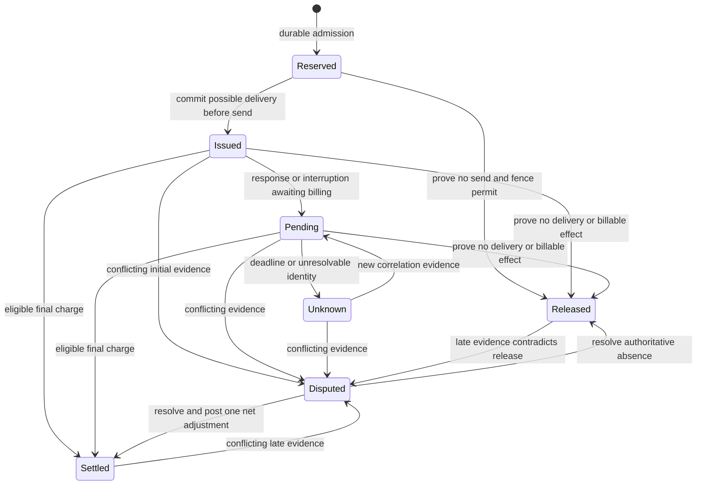

# M1-09 Spending limits and reconciliation

**Recommendation — Conditional.** Evaluate a coordinator-owned ledger and a trusted model broker in the no-charge fixture. Enable autonomous paid inference only for a route whose submission count, maximum customer charge, and settlement rules have been qualified. This is a research proposal for [Issue #9][i9], based on the [vision](../docs/vision.md), [draft requirements](../docs/requirements.md), and [draft architecture](../docs/architecture.md).

## Evidence and scope

| Status | Evidence |
| --- | --- |
| **Source-confirmed** | OpenHands SDK and Agent Server `v1.62.0`, commit `504a88cab0fb48ee5226238ad7b8f1d865fa84a8`, with LiteLLM `1.105.1` in the SDK lock. The baseline is the Agent Server's local conversation runtime inside the project's proposed isolated deployment, using Chat Completions. [Issue #1][i1] · [SDK lock][oh-lock] · [Executor research](openhands.md) |
| **Source-confirmed** | OpenRouter Chat Completions, routing and generation lookup are hosted contracts. M1-03's review baseline is 2026-11-16 US Eastern. The relevant public API docs were rechecked on 2026-11-17. The candidate uses a dedicated inference key and prepaid credits. This assessment covers that billing path. [Issue #3][i3] · [Routing research](model-routing.md#m1-03-openrouter-findings) · [Chat][or-chat] · [Generation lookup][or-gen] |
| **Measured** | No upstream inference, executor or billing measurements. The worked example contains illustrative amounts. The test specifications describe expected outcomes. |
| **Open** | The [validation gates](#open-findings-and-next-checks) cover runtime enforcement, hosted charge bounds, ID correlation and settlement. |

The coordinator owns approval records, reservations, ledger postings and reconciliation decisions. The broker is its trusted network boundary for model calls. It acts on a durable coordinator permit and journals wire evidence. OpenHands, LiteLLM and providers supply observations. The proposed separation follows the [planning handoff](planning-execution-handoff.md), [recovery rules](autonomy-recovery.md#recovery-invariants-and-retry-policy) and [revision-bound verification](verification-integration.md).

## Budget model

Use a developer-approved, immutable budget revision bound to the plan, policy and authority generation. Every limit is cumulative for its scope. Keep settled charges and live reservations across worker restarts, correction attempts and approval revisions. A replacement grant specifies new absolute limits and carries forward the same spend history. Persist money as integers in an approved billing unit and precision. Round bounds up. Preserve source amount, currency or credit unit and exact conversion evidence. The fixture uses USD and no conversion. Deny a paid path whose price or conversion cannot be bounded.

| Scope | Hard limits and admission rule |
| --- | --- |
| Model request | One permit per physical upstream POST. Cap input, total context, billable output, billable units and maximum charge. Bind one concrete model, endpoint, service tier and feature set. Cap calls and wall time higher in the hierarchy. |
| Execution attempt | Cap cumulative spend plus outstanding exposure, model submission count, and time. Consume an attempt slot durably at admission. Charge compaction, agents and other auxiliary inference to the attempt and its task. A resumed run keeps the same cumulative counters and consumes a separate approved resume slot. |
| Task and retries | Cap total spend across initial, failed, cancelled and corrective work, including verification. Assign implementation and verification allowances beneath the task cap to protect mandatory review. Limit attempts, corrections and repeated operations. A closed child returns eligible monetary headroom to its parent through settlement within the approved allocations. |
| Independent verification and review | Give each task a protected cap for candidate checks, review, re-review and integrated checks, with operation counts and deadlines. Require a separate review principal and a candidate or integrated revision binding. Meter any billable checks with bounded permits. Budget local jobs in resource units such as CPU time, and report estimated use in the economic totals. A spent review allowance blocks acceptance when evidence is missing. |
| Milestone | Apply the hard cap across task and shared overhead, including planning, preflight calls with charges, shared verification and reporting. Assign overhead an explicit allowance. Enforce all applicable caps in one transaction. Begin with sequential tasks and one upstream model request in flight. |
| Fallback and escalation | Baseline allows zero hidden fallbacks or transport retries. A policy revision may authorize a finite list of eligible escalation profiles, triggers, path-specific caps and retry counts. The coordinator chooses the next route after a diagnosed outcome and opens a new admission for each physical POST. For a hosted internal multi-attempt path, require a proven maximum number and aggregate price of all chargeable upstream attempts and enforce its aggregate bound before allowing it. |

For each applicable scope let `L` be the approved cap, `S` the sum of settled debits with evidenced adjustments, and `R` the sum of outstanding reservations. **Remaining authorization is `L - S - R`.** Compare the proposed bound `B` to this value at every applicable scope and require `S + R + B <= L`. A reservation counts once in each ancestor view. Roll up unique ledger entries to obtain the milestone total. Open attempt or task allocations are ceilings under this model. They do not create additional ledger debits.

- **Reserved exposure** covers all unsent, in-flight, pending and unknown holds. **Unresolved exposure** is the part held for pending or unknown submissions, including any authorized residual. The original reservation stays on the record after release for audit.
- **Settled charge** is the coordinator's posting based on eligible evidence of a final amount. **Estimated cost** is a labeled calculation, such as provisional token pricing or local compute allocation. It does not consume or restore cash headroom in addition to a held bound.
- **Unknown charge** has no defensible exact amount. Store a null amount with a reason and retain its bound. When a bound itself is invalid, record unbounded exposure and freeze the affected spending domain. Make any arithmetic headroom and actual dispatch permission separately visible.

### Bounding one request

For an eligible route, compute an upper bound on the full customer charge for the exact serialized request and its permitted provider-side transformations. Include message framing, tool definitions and results, history, system prompts and provider overhead in the input bound. Validate separate input, output and combined context limits. Use an output cap proven to cover every billable generated unit, including reasoning and tool arguments. Reject unsupported or ambiguous caps and requests that may be truncated or transformed outside the approved bound.

For a text-only profile, the basic bound is the sum of upper input and output units times their maximum applicable rates, plus maximum fixed fees and any other enabled billable dimensions. Use mutually exclusive billing buckets or add only the incremental surcharge for overlapping buckets. Bound cache misses at full rate and possible cache writes at the applicable maximum. Include paid tiers, rounding and any per-request service fee. For the first hosted path disable unqualified plugins, paid tools, alternate modalities, dynamic presets, response caching and BYOK. Snapshot the model, exact endpoint, billing tier, unit/rate table, effective time, expiry, input counting method, output-cap semantics and provenance. Expired data or unenforceable ceilings block dispatch. If choosing among mutually exclusive routes with a single charge, use the maximum route bound. If multiple attempts can be charged, reserve the sum over the worst permitted sequence. [Provider rate filters][or-provider] · [Endpoint catalog][or-endpoints] · [Reasoning tokens][or-reason] · [Usage accounting][or-usage]

The broker authenticates the attempt and role with a scoped identity, checks current authority and holds, validates the exact outbound payload, and commits the reservation and submission ID before any external send. Serialize admission with concurrent reservations, settlement, fencing and revocation across every affected counter and cap. Deny when the ledger is unavailable. Keep provider credentials and egress at the broker. Block direct provider access and alternate billable paths from every executor, reviewer and tool runtime. The broker independently validates the actual route configuration and price limits so executor configuration cannot grant spend. [Handoff contract](planning-execution-handoff.md#dispatch-observation-and-integration) · [Execution security](execution-security-boundary.md)

Bind each permit to a trusted logical model operation ID and an explicit submission ordinal. The trusted adapter must keep the logical ID stable across duplicate delivery or SDK replay, and only the coordinator can issue another ordinal. A reusable attempt credential identifies the caller. It cannot authorize a new outbound POST by itself. A repeated permit returns the recorded disposition or a hold without sending upstream. Equal prompt digests are insufficient for identifying duplicates. Qualify how the adapter obtains and carries a distinct operation identity for each legitimate turn and auxiliary call. Hold executor paths where a hidden retry can masquerade as a new authorized operation.

Prefer fixed profiles for the first measured baseline. Later eligible deterministic profiles can be ranked by their total cost per accepted task under a shared quality floor, with a stable policy tie-break. In a single run, preserve verification capacity, use local deterministic checks where approved, and allow corrections only after diagnosis. Compare quality and cost on the same fixture and rubric. Do not infer savings from nominal token rates. [Model evaluation](model-routing.md#proposed-synthetic-repository-evaluation)

## Ledger schema

Use an append-only journal as the audit record and transactional balances as a derived projection. Each event has an ID, prior record version, timestamp, actor, reason, authority generation and evidence references. Keep original records after supersession. Store sanitized metadata and evidence digests, with credentials and prompt or completion content excluded from accounting records.

| Record | Required fields and identity |
| --- | --- |
| Budget grant and policy | Unique `budget_id` and revision, `approval_id`, approver and expiry, plan revision and digest, milestone ID, policy/profile revisions, authority generation, scope/parent IDs, monetary unit and limits, count and time limits, route/fallback rules and predecessor grant. |
| Work and role binding | Milestone, task and attempt IDs, run-operation ID, role, executor deployment and conversation UUID, candidate or integrated revision and verification/review operation as applicable. Milestone overhead uses an explicit work scope. IDs for roles or scopes without a task or executor are null with a stated reason. |
| Price snapshot | `price_snapshot_id`, requested model, eligible endpoint and tier, input counting method, context and output limits, price ceilings by charge dimension, billable features, rounding/conversion and effective window. Store bound inputs and computed result. |
| Submission and reservation | Coordinator `submission_id` and `reservation_id`, logical operation ID and submission ordinal, work binding, grant and policy revisions, requested model/provider endpoint and tier, request digest, chosen limits, original and current hold, delivery state and scoped sender permit, deadlines and known failure phase. Uniqueness on operation and ordinal prevents duplicate permits. |
| Observation | Unique source-scoped observation ID or canonical digest, observed/received times, submission join evidence and gateway/account identifiers. Store gateway generation ID, gateway request ID, upstream ID, SDK response ID, executor event ID and session ID separately. Record resolved model, endpoint/provider and tier with provenance, routing attempts, status, termination and cancellation evidence. Preserve input/output totals and native/normalized token counts, reasoning and cache buckets, source-specific field names, reported amount/unit, estimated amount/method and null reasons. |
| Charge and adjustment | Canonical charge key, owning submission, reconciliation state, settled amount or null, evidence IDs, applied revision and reason. On the prepaid gateway path key the charge by billing gateway, billing account and generation ID. An invoice line or stable component from a different billing system needs its own accounting namespace and an explicit match or non-overlap rule. Store corrections as ordered deltas on the same charge. |
| Hold and disposition | Scope and reason, unresolved upper bound, implicated submissions, evidence, created time, deadline, fence status, and current decision. A developer residual grant also records authenticated approver, precise exposure and permitted actions, caps, expiry, and policy/authority revision. |

A generation ID, request ID, upstream ID and conversation UUID have different scopes. An account-scoped generation key can own only one submission for this path. If the same key is claimed by two submissions, flag a conflict and keep the second hold while investigating. Distinct generations remain potential separate liabilities even if their prompts or SDK IDs match. A duplicate upstream POST is an incident, and may create another charge.

## Reconciliation

- **Before and after send.** Persist `Reserved`, then atomically consume the one-use permit and persist `Issued` before writing to the network. A crash between the `Issued` write and transport receipt leaves possible delivery. A stale worker is fenced at the actual sending boundary. Never reissue an `Issued` request on a restarted sender. Prove non-delivery using trusted transport evidence and fence the old sender before releasing. If a final bill proves an explicit zero for a submitted call, record `Settled(0)`. Treat a timed-out, failed or cancelled call as possibly billable until qualified evidence resolves it.
- **Observe and match.** Persist the earliest gateway generation ID and safe metadata from the upstream wire. With a known ID, use bounded, read-only lookup until the persisted deadline. A delayed record or lookup 404 keeps the reservation. Without an ID, use an approved account log/export with a proven unique join to that submission. A key/time window or a conversation ID that identifies several calls cannot settle any of them. Track mismatched IDs, units, destinations, tokens or prices without overwriting observations. [Generation lookup][or-gen] · [Logs][or-logs]
- **Post one charge.** Use a policy-specific evidence hierarchy that validates provenance, account, ID, unit, scope and finality. Record terminal `usage.cost` as reported and look up `data.total_cost` for reconciliation. Authorize settlement and release from a receipt only once that evidence type is qualified as final for admission. Until then, retain the complete bound, even against plausible provisional costs. If the provider can revise charges, retain the full bound until finality or a separately proven bound on the remaining adjustment. Executor aggregates, estimates and account balance deltas cannot settle individual charges. Compare balances and invoices as aggregate controls. [Usage accounting][or-usage] · [Generation lookup][or-gen]
- **Replay and crash recovery.** In one durable transaction deduplicate evidence, claim the charge identity, append the posting or adjustment, update holds and balances, and record the ledger version. A crash before commit leaves the prior hold intact. A crash after commit leaves exactly one posting even if the acknowledgement was lost. Recover durable authority, scan open intents, rebuild or verify balances and reconcile before reopening dispatch. Never replay external inference as a side effect of settlement replay.
- **Conflict and late correction.** On a conflicting duplicate or late correction, quarantine evidence and stop admissions in the affected domain while verifying against the authoritative billing record. Keep the applicable bound for the liability above any amount already posted. Append a single evidenced adjustment keyed by the charge and authoritative correction ID, including a reversal if qualified evidence invalidates a prior posting. Never add two representations of one charge. Record credible breaches or unallocated account debits as incidents and post confirmed actual spending even if it exceeds authorization. An unexpected upward adjustment after qualified release contradicts a bound or finality assumption. Freeze the route and recompute exposure before any reopening.

### Stop and residual authority

An on-time response with settlement pending, an interrupted or ambiguous send, missing or conflicting billing, invalid bounds, exhausted caps or a policy denial fence further billable submissions in the milestone. Stop the affected attempt at the broker, initiate executor stop when it cannot continue safely, and preserve evidence. Block new actions from partial or unqualified model output. A still-running request stays covered by its original cap. Normal in-flight work retains its reservation and the baseline has no parallel model dispatch. If identity, meter finality or a finite bound cannot be established, keep the appropriate hold across restart. Expand the fence to the credential/account when shared activity could undermine the bound.

The developer may explicitly authorize continuation with a named, **bounded** residual charge after the old runtime and sender are fenced, effects have been reconciled or contained under the recovery policy, and the original call cannot be replayed. The grant must name the held submissions, enforced worst-case remaining amount, permitted fresh actions and expiry. The full residual stays charged against every applicable cap as a reservation, with actual cost labeled unknown. All new requests still pass admission, review and scope gates. A new absolute budget can add headroom through a separate approved revision. An unbounded exposure, an unqualified meter, or unresolved unsafe effects prevent continuation under this exception. [Recovery rules](autonomy-recovery.md#recovery-invariants-and-retry-policy)

## Synthetic milestone

**Illustrative figures only.** M-CLI1 uses approval `AP-01`, budget `B-01` and spending policy `SP-01`. T-02 consumes T-01's accepted integration revision. Set a $1.50 milestone inference cap, partitioned into $0.50 for T-01, $0.80 for T-02 and $0.20 for shared overhead. Within each task protect $0.16 for verification and review. Each implementation attempt has a $0.32 cap and at most three submissions. Both tasks have one initial attempt. T-02 has one preapproved correction following a known failure. Each task allows one independent review operation with one submission. Shared overhead allows one closeout submission. Permit zero transport retries and zero hidden fallback. The local checks and integrated regressions are separately resource-capped. These figures illustrate accounting. [Issue #10][i10] owns the fixture thresholds and approval.

The synthetic billing authority charges $10 per million input tokens and $20 per million output tokens, with no fixed fees or later adjustments. The implementation request ceiling is $0.24 for 12,000 input and 6,000 output tokens. Review and closeout requests each reserve at most $0.12 for 6,000 input and 3,000 output tokens. Every request pins the same fictional model and endpoint, `fixture/model-v1` and `fixture/endpoint-a`. Where a row has matched final evidence, the resolved route equals the requested route. S6's resolved route is unknown.

### Before reconciliation of the failed attempt

T-01 passes candidate checks, independent review and integrated regressions, and its acceptance is durable. T-02 starts from T-01's accepted revision. Its first implementation attempt fails without a candidate. The broker has its generation ID, a provisional estimate derived from fixture telemetry and an initial lookup miss. The failure triggers a spending hold before another POST.

| Submission | Work | Generation | State | Settled | Pending estimate | Open hold |
| --- | --- | --- | --- | ---: | ---: | ---: |
| S1 | T-01 / A1 implementation | G1 | Settled | $0.12 | | $0.00 |
| S2 | T-01 / V1 independent review | G2 | Settled | $0.04 | | $0.00 |
| S3 | T-02 / A2 failed implementation | G3 | Pending | | $0.09 | $0.24 |

Known spending is **$0.16**. Estimated unsettled inference is **$0.09** within the **$0.24** unresolved exposure. Estimated local verification already incurred is **$0.06**. Remaining milestone authorization is **$1.10** ($1.50 − $0.16 − $0.24) and the hold prevents new submissions.

### After reconciliation and the subsequent authorized work

G3 appears in lookup with a final $0.08 charge. The coordinator replaces the $0.24 hold with the $0.08 settlement. Headroom becomes $1.26 before the next reservation. After diagnosing the failure and confirming stop, the coordinator charges the approved correction slot and runs A3. T-02 passes independent review and the other acceptance gates, and its integration is durably accepted. An optional, already-approved milestone closeout summarizer then loses its connection after sending, before any ID or usage. Log matching remains ambiguous at the deadline. The coordinator keeps the S6 hold and generates the developer report locally from ledger data.

| Submission | Work | Generation | Final billed input / output tokens | State and evidence | Original bound | Settled | Open hold |
| --- | --- | --- | --- | --- | ---: | ---: | ---: |
| S1 | T-01 / A1 implementation | G1 | 8,000 / 2,000 | Settled, fixture receipt | $0.24 | $0.12 | $0.00 |
| S2 | T-01 / V1 independent review | G2 | 3,000 / 500 | Settled, fixture receipt | $0.12 | $0.04 | $0.00 |
| S3 | T-02 / A2 failed implementation | G3 | 6,000 / 1,000 | Settled, delayed fixture lookup | $0.24 | $0.08 | $0.00 |
| S4 | T-02 / A3 authorized correction | G4 | 9,000 / 3,000 | Settled, fixture receipt | $0.24 | $0.15 | $0.00 |
| S5 | T-02 / V2 independent review | G5 | 4,000 / 500 | Settled, fixture receipt | $0.12 | $0.05 | $0.00 |
| S6 | Milestone / C1 closeout | Missing | Unknown | Unknown, possible send and ambiguous logs | $0.12 | | $0.12 |

- **Known inference spend:** $0.44, including the failed attempt ($0.08) and both independent reviews ($0.09). Task totals are $0.16 for T-01 and $0.28 for T-02.
- **Estimated spending:** $0.10 of local verification ($0.06 for T-01 and $0.04 for T-02). The superseded $0.09 estimate remains in history. S6 has no point estimate.
- **Unresolved exposure:** $0.12 for S6. **Remaining authorization:** $0.94 ($1.50 − $0.44 − $0.12). Billable dispatch stays held despite the arithmetic headroom.

### Cost per accepted task

Divide the milestone cost of **all started work** by the count of unique, durably accepted task revisions under that milestone's approved fixture and rubric. For comparisons, count at most one acceptance per task trial. Include implementation, failed and abandoned work, retries, verification and independent review, and attributable planning, integration, escalation and reporting. Include separately identified infrastructure or labor estimates when the comparison assigns those costs. Keep actual charges, point estimates and maximum unresolved exposure visible. When no tasks are accepted, report the numerator and no finite cost per accepted task.

Here two tasks are accepted. **Known cost per accepted task is $0.22** ($0.44 / 2). Including estimated local verification gives **$0.27 per accepted task** (($0.44 + $0.10) / 2), before any S6 charge. Holding that local estimate fixed, the illustrative range is **$0.27–$0.33** with S6 between $0 and $0.12. This range is conditional on the synthetic charge bound and does not settle S6.

## Enforcement and integration matrix

**Supported** means a pinned interface or hosted contract exposes the stated capability. **Translation** requires a trusted adapter or a coordinator rule. **Unresolved** requires validation before relying on the capability. Source-confirmed metadata availability on the gateway wire and its survival through the executor are different checks.

| Capability | Class and evidence | Enforcement or remaining check |
| --- | --- | --- |
| Task, attempt, conversation and role identity | **Supported / Translation.** OpenHands accepts a preassigned conversation UUID and surfaces events and stats. The coordinator owns task, attempt, run-operation and per-submission IDs. [OpenHands request][oh-request] · [Executor research](openhands.md) | Bind a broker principal to the stored attempt, role and authority generation. Conversation, event and session IDs correlate activity. They cannot establish a unique paid request. |
| Admission, caps and egress | **Translation.** OpenHands supports a configured base URL and Chat options. Its cost check runs after agent steps. [Chat options][oh-chat] · [Agent settings][oh-request] · [Executor usage research](openhands.md#lifecycle-map) | Broker owns network permission, canonical request validation and one-shot permits. Coordinator atomically checks all caps. Deny stale permits, unapproved credentials or destinations, and any physical send without a live reservation. |
| Requested versus resolved route | **Supported / Translation.** OpenRouter supports explicit model and provider filters, a price filter and opt-in route metadata. Provider display names and endpoint slugs have different meanings. Accessible private endpoints can remain eligible outside a nonempty `order` even when fallbacks are disabled. The private-endpoint guide directs callers to `only` to constrain this case. [Chat][or-chat] · [Provider routing][or-provider] · [Private endpoints][or-private] · [Router metadata][or-meta] | Pin one explicit public model and full endpoint in both `provider.only` and `provider.order` with `allow_fallbacks: false` and `require_parameters: true`. Request metadata with `X-OpenRouter-Metadata: enabled`. Apply approved privacy fields and verify effective account settings, including absence of private endpoint and BYOK access for this baseline. Deny `models`, aliases and routes that could override the pin. Resolved identity and exact endpoint variant remain **unresolved** until proved on wire or reliable lookup. |
| Gateway generation and auxiliary IDs | **Supported** at the gateway. Chat JSON/SSE carries a generation `id` when returned. Lookup can expose `request_id`, `upstream_id`, session and provider details. No guaranteed early ID or client-key inference lookup was established in M1-03. [Chat][or-chat] · [Generation lookup][or-gen] · [M1-03 interruption trace](model-routing.md#3-interrupted-request) | Capture raw metadata before normalization. Use separate nullable fields. **Unresolved** for mapping without a generation ID or after interruption before any ID arrives. |
| IDs, usage and routing through LiteLLM/OpenHands | **Supported / Translation.** Source takes `id`, `model`, `usage` and choices into normalized chunks. Top-level provider and routing metadata are omitted on that stream path. A structured SSE error can raise without a structured chunk ID. In non-streaming mode LiteLLM can copy `usage.cost` into a hidden cost field. OpenHands exposes a normalized response ID in its wrapper and some events. Its telemetry can use a reported cost or calculate a price estimate. Conversation stats expose aggregate token/cost evidence with no generation ID on cost entries. [LiteLLM adapter][lit] · [SDK response][oh-response] · [Event dispatch][oh-dispatch] · [Telemetry][oh-telemetry] · [Stats][oh-stats] | Store executor IDs and observed counts separately. **Unresolved** whether final normalized response IDs equal raw generation IDs in every mode and whether terminal evidence survives restart. Broker capture and scoped joins are the accounting path. |
| Retries, fallback and denial | **Supported / Translation.** The pinned SDK wraps transient calls with retries. The Chat path normally sets lower-level `max_retries: 0`. OpenRouter also supports gateway-internal routing and fallback. [SDK LLM][oh-llm] · [Retry wrapper][oh-retry] · [Model fallback][or-fallback] | Set `num_retries: 0` and no SDK fallback strategy. Disable client, HTTP proxy and redirect replay. Reject extra calls with revoked or already consumed authority. Any coordinator-authorized physical retry receives a new submission and budget decision, with documented safe disposition of the original. Stable broker operation identity through the pinned call paths is **unresolved**. Validate typed denials, replay identity and actual POST counts. |
| Provider budgets and actual charges | **Supported / Unresolved.** Key/workspace budgets and `max_price` constrain scopes or rates. Chat usage and generation lookup report per-generation evidence. [Limits][or-limits] · [Workspace budgets][or-budgets] · [Usage][or-usage] · [Generation lookup][or-gen] | Keep aggregate controls as backstops. The broker still needs a bound for the actual billed units and number of chargeable attempts. Validate caps, publication lag and finality separately. Do not settle from account credit movements, token estimates or nominal endpoint price. |
| Interrupts, late reports and exhaustion | **Translation / Unresolved.** OpenHands interrupt acknowledgement may precede quiescence. Hosted cancellation and billing depend on the provider and mode. [OpenHands stop](openhands.md#lifecycle-map) · [Streaming][or-stream] | Fence permits, persist possible send, and reconcile from raw IDs or proven log joins. Keep the hold on missing evidence, including unsuccessful calls. At exhaustion reject the next permit before I/O. Hold any unaccepted work without its required evidence. |

A safe transient retry requires proven non-delivery, a qualified typed pre-provider denial with no billable effect, or settlement of a known attempt plus satisfied effect and correction gates. A bare HTTP code or retry hint is insufficient evidence of delivery phase. Apply any permitted backoff within the original deadline and durable count. Stop on policy, capability or moderation denials. Qualify handling for 402, 429, 503 and timeouts before enabling any retry class. [M1-03 routing contract](model-routing.md#proposed-routing-and-accounting-contract) · [HTTP retry semantics][http]

## Issue #13 validation specifications

Use the [Issue #10][i10] two-task fixture and its approved thresholds for the integrated baseline. Use isolated test cases for injected gateway failures. Run the pinned SDK and Agent Server with the LiteLLM version actually recorded at runtime. Use a trusted scripted Chat endpoint behind the broker with a dummy credential, synthetic prompts, a fixture clock and explicit barriers. Reset the ledger, account namespace, sandbox and mock state between cases. Script each outbound response and lookup by submission order or generation ID. For C and D, run lookup or log checks at fixture ticks 1, 2 and 4 after the interruption, with a deadline at tick 8. Use independent mock wire counts to detect hidden replay. Include implementation, review and the enabled auxiliary role paths. [Issue #13][i13] · [M1-03 fixtures](model-routing.md#required-fixtures-and-open-findings)

| Case | Setup and injection | Expected ledger, stop decision and pass evidence |
| --- | --- | --- |
| A. Success and explicit zero | Return JSON and SSE success, with a terminal charge, exact resolved identity and cache/reasoning fields. Record request, raw generation, response and event IDs. Repeat with a qualified final zero and separately with missing usage. Run both tasks with their independent reviews. | `Reserved → Issued → Settled` exactly once per qualified charge. In the SSE case persist the first ID before terminal usage. Each lookup echoes the same canonical charge and each reviewed SHA has its own operation binding. Qualified zero settles; missing usage stays pending and blocks new dispatch. Require one acceptance per task and no early dependent release. |
| B. Forbidden fallback | Send a request carrying a forbidden `models` override. In the upstream simulation, make the pinned endpoint unavailable and an unlisted endpoint the only viable alternative. Have the mock select only from endpoints allowed by the received flags. Prove the alternate is reachable in a separate mock-only permissive control. Inject a structured denial, an error inside HTTP 200 and a mismatched resolved endpoint. | Local override produces zero POSTs. The denied upstream simulation sees one pinned POST and zero attempts to the alternate. A proven no-effect denial releases the hold while stopping automatic retries. Any ambiguous denial keeps the hold. A mismatched resolved route stops and quarantines output. Record outbound body, route attempts, actual counts and zero tools from the rejected response. |
| C. Delayed billing and correction | Replay S3. Emit G3, fail the operation with no candidate, omit final usage, return 404 at tick 1, then the final $0.08 row at tick 2. Submit a valid-looking next call between lookup results. | `Issued → Pending → Settled`. The intervening call is rejected before I/O. $0.24 remains held while pending. The later $0.08 posting frees $0.16 once. Only after prior effects and stop are resolved may the preapproved correction receive its own attempt and submission IDs. |
| D. Missing IDs and bounded residual | Drop after send but before any ID. Make logs empty or present two plausible matches. Advance past the deadline and restart. Try a new POST with no grant, then with a scoped residual grant and available cap. Repeat with an invalidated old bound. | `Issued → Pending → Unknown` survives restart with null charge and held bound. No inference on a missing, expired or out-of-scope grant. A valid grant allows only its fresh action under all caps and retains the old liability. The negative control with an invalid bound stays fenced. Assert no match by guess and no replay of the ambiguous POST. |
| E. Duplicate and conflicting evidence | Replay response, lookup and settlement messages in different orders, including after restart. Submit the same generation against another submission. In a separate run present a conflicting cost and replay a uniquely identified billing correction. | Identical observations have one economic effect and a repeat settlement is a no-op. Cross-submission duplicate and conflict stop admission and retain applicable liability. The validated correction posts one net delta. An additional genuine generation produces its own charge and flags any unpermitted send. |
| F. Interruption and crash | Inject faults before `Issued`, after `Issued` but before a network receipt, after send before an ID, after the first SSE ID and before terminal usage, and immediately before/after the settlement transaction commits. Try a stale sender token and restart the coordinator. Inject a transport retry with the original operation ID. | Only trusted proof of no send with a fenced permit releases early. Possible delivery retains the bound; an early ID enables lookup. Partial tool output yields zero tool actions. Restart preserves fences and reconstructs the same totals. The duplicate operation sends no second POST. No unqualified resend, duplicate posting or lost charge across the transaction boundary. |
| G. Budget exhaustion and concurrency | Seed $0.44 settled and a $0.12 retained residual under a disposition covering both contenders. Under a $0.70 test cap, race two $0.12 admissions with sufficient child caps at the ledger transaction boundary and hold the sender until both decisions return. Exercise the budget race separately from the one-request concurrency gate. Try an individually over-cap request and exhausted implementation and review allocations. Repeat with expired price data and stale authority. | One racing reservation can commit ($0.68 exposure), and a second would reach $0.80 and is denied before send. Individually over-cap, stale and unbounded requests send zero POSTs. Implementation cannot consume protected review funds. Exhausted required review holds acceptance. All projections match the journal after restart. |

Capture a manifest of versions and image digests, fixture IDs, configuration hashes, exact fault points and clock steps. Retain sanitized outbound and inbound metadata, broker permit and POST logs, lookup fixtures, executor IDs/events/stats, the ledger journal and balances, stop/fence evidence and acceptance decisions. **Pass** requires every expected ledger effect, enforced stop and negative wire assertion. Any forbidden POST, duplicate debit, unsubstantiated release, dropped required identity or spend above an enforced bound fails. Missing instrumentation makes a case inconclusive and keeps its capability open. Label future local results **measured, simulated**. Hosted routing, price enforcement and billing remain separate measurements using confirmed no-charge scenarios where applicable or explicitly authorized paid synthetic tests.

## Open findings and next checks

| Status | Finding | Next check or adoption gate |
| --- | --- | --- |
| **Open** | Effective broker isolation, durable commits and stale-sender fencing depend on the target runtime and storage. | Run #13 G/F on the selected store and process boundary. Prove restart durability and stale-worker denial. Coordinate egress, credential and teardown checks with the [execution security research](execution-security-boundary.md) and [recovery research](autonomy-recovery.md). |
| **Open** | Exact emitted route flags, pin enforcement, resolved endpoint variant, logical operation permit mapping and per-mode ID survival are unverified across actual deployment roles. | Run #13 A/B/F through the pinned Chat stack. Trace stable logical IDs through retries and distinct valid turns. Confirm actual hosted single-endpoint routing and endpoint attribution with authorized access before enabling it. Qualify other APIs and permitted internal fallback separately if selected. |
| **Open** | OpenRouter catalog and filters do not by themselves establish a hard bound on all chargeable units or attempts. | Qualify the selected endpoint's tokenization and reasoning caps, cache/fee rules, rate ceilings, number and billing of internal attempts and effective account tier. Use the provider's authoritative contract and scoped validation. A route with an unenforceable bound is ineligible. |
| **Open** | Charge finality, delayed lookup, interruption billing and possible missing-ID recovery have no qualified hosted guarantee here. | Run #13 C–F locally, then compare terminal usage, generation lookup and available billing/export evidence for authorized hosted cases. Establish finality and correction rules, a unique join or a durable unknown outcome, actual lag and the cancellation behavior of the selected endpoint. Hold or disable paths without qualified settlement and bounded exposure. |
| **Open** | Cost or quality improvement is unmeasured. | Issue #10 freezes the budget, retry, quality and intervention thresholds. Once required boundaries qualify, compare the fixed-model baseline and eligible deterministic selection under the same rubric and include recovery and independent review costs. |

**Conclusion — Conditional.** Advance the ledger and broker contract to issue review and the synthetic fixture. Independent review should trace `AP-01 → attempt → reservation → POST → charge → report` and verify that neither ambiguity nor a retry can free an unproven liability. Autonomous paid execution depends on measured boundary enforcement and qualified hosted charge bounds and settlement.

[i1]: https://github.com/taggedzi/ai-dev-orchestrator/issues/1
[i3]: https://github.com/taggedzi/ai-dev-orchestrator/issues/3
[i9]: https://github.com/taggedzi/ai-dev-orchestrator/issues/9
[i10]: https://github.com/taggedzi/ai-dev-orchestrator/issues/10
[i13]: https://github.com/taggedzi/ai-dev-orchestrator/issues/13
[oh-lock]: https://github.com/OpenHands/software-agent-sdk/blob/504a88cab0fb48ee5226238ad7b8f1d865fa84a8/uv.lock#L1991-L1994
[oh-request]: https://github.com/OpenHands/software-agent-sdk/blob/504a88cab0fb48ee5226238ad7b8f1d865fa84a8/openhands-sdk/openhands/sdk/conversation/request.py
[oh-chat]: https://github.com/OpenHands/software-agent-sdk/blob/504a88cab0fb48ee5226238ad7b8f1d865fa84a8/openhands-sdk/openhands/sdk/llm/options/chat_options.py
[oh-llm]: https://github.com/OpenHands/software-agent-sdk/blob/504a88cab0fb48ee5226238ad7b8f1d865fa84a8/openhands-sdk/openhands/sdk/llm/llm.py
[oh-retry]: https://github.com/OpenHands/software-agent-sdk/blob/504a88cab0fb48ee5226238ad7b8f1d865fa84a8/openhands-sdk/openhands/sdk/llm/utils/retry_mixin.py
[oh-response]: https://github.com/OpenHands/software-agent-sdk/blob/504a88cab0fb48ee5226238ad7b8f1d865fa84a8/openhands-sdk/openhands/sdk/llm/llm_response.py
[oh-dispatch]: https://github.com/OpenHands/software-agent-sdk/blob/504a88cab0fb48ee5226238ad7b8f1d865fa84a8/openhands-sdk/openhands/sdk/agent/response_dispatch.py
[oh-telemetry]: https://github.com/OpenHands/software-agent-sdk/blob/504a88cab0fb48ee5226238ad7b8f1d865fa84a8/openhands-sdk/openhands/sdk/llm/utils/telemetry.py
[oh-stats]: https://github.com/OpenHands/software-agent-sdk/blob/504a88cab0fb48ee5226238ad7b8f1d865fa84a8/openhands-sdk/openhands/sdk/conversation/conversation_stats.py
[lit]: https://github.com/BerriAI/litellm/blob/v1.105.1/litellm/llms/openrouter/chat/transformation.py
[or-chat]: https://openrouter.ai/docs/api/api-reference/chat/create-a-chat-completion
[or-provider]: https://openrouter.ai/docs/guides/routing/provider-selection
[or-private]: https://openrouter.ai/docs/guides/routing/private-endpoints#private-endpoints-and-disabled-fallbacks
[or-endpoints]: https://openrouter.ai/docs/api/api-reference/endpoints/list-all-endpoints-for-a-model
[or-reason]: https://openrouter.ai/docs/guides/best-practices/reasoning-tokens
[or-fallback]: https://openrouter.ai/docs/guides/routing/model-fallbacks
[or-meta]: https://openrouter.ai/docs/guides/routing/routers/router-metadata
[or-usage]: https://openrouter.ai/docs/cookbook/administration/usage-accounting
[or-gen]: https://openrouter.ai/docs/api/api-reference/generations/get-request-%26-usage-metadata-for-a-generation
[or-logs]: https://openrouter.ai/docs/guides/features/logs
[or-limits]: https://openrouter.ai/docs/api_reference/limits
[or-budgets]: https://openrouter.ai/docs/guides/features/workspaces/workspace-budgets
[or-stream]: https://openrouter.ai/docs/api_reference/streaming
[http]: https://www.rfc-editor.org/rfc/rfc9110.html#section-9.2.2
