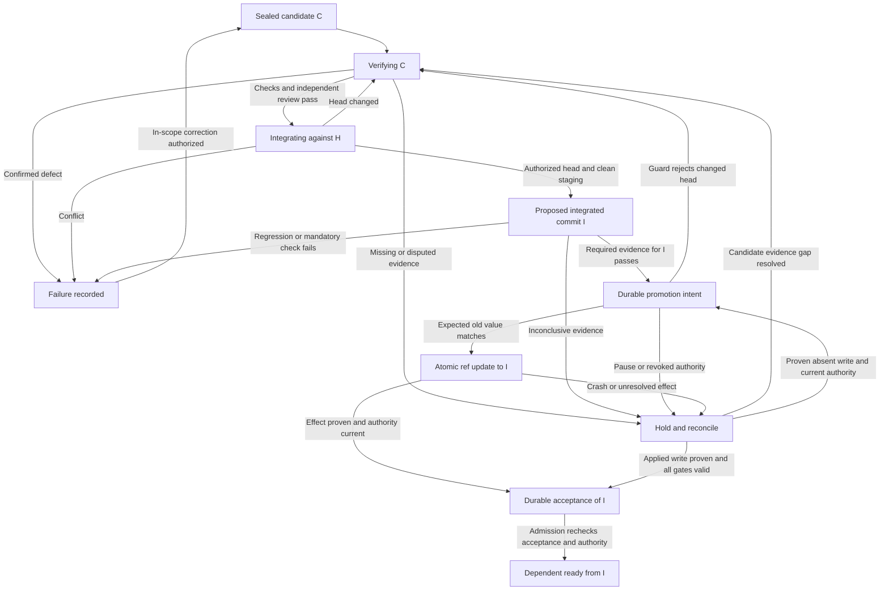

# M1-08 Revision-bound verification and integration

**Recommendation — Conditional.** Require mandatory checks on the sealed candidate, an independent review of that candidate, and regression checks on the exact proposed integrated commit. A trusted Git process promotes only that tested commit. The coordinator records acceptance durably before releasing dependents. Qualify this design in the M1-05 synthetic milestone before enabling unattended integration. [Issue #8][i8] · [Issue #10][i10] · [Draft requirement R4](../docs/requirements.md)

## Evidence and scope

| Classification | Evidence and baseline |
| --- | --- |
| **Source-confirmed** | Git **v2.51.0** documents a guarded ref update with an expected old object ID (OID), merge-tree staging without a checkout or index, explicit commit parents, and configurable object and ref hardening. Linked worktrees share repository data. These primitives support the proposed design. The coordinator ledger and recovery protocol are project responsibilities. [Ref updates][git-ref] · [Merge tree][git-merge] · [Commit tree][git-commit] · [Durability settings][git-config] · [Worktrees][git-worktree] |
| **Source-confirmed** | M1-05 pins GSD Core **v1.21.0**, commit `357508df233ccca0dcf4332b385d6bee9b113da9`, with planning snapshot schema 1 and raw PLAN files. It pins OpenHands SDK and Agent Server **v1.62.0**, commit `504a88cab0fb48ee5226238ad7b8f1d865fa84a8`. The reviewed executor supplies workspace, conversation, and event observations. Canonical candidate intake, adjudication, and promotion are proposed coordinator functions. [GSD CLI][gsd] · [OpenHands request][oh-request] · [OpenHands events][oh-events] · [M1-05 handoff](planning-execution-handoff.md) |
| **Source-confirmed** | Node.js **v22.16.0** documents its built-in test runner and failed-test exit status. ECMA-262 **16th edition (2025)** defines the stateful regex behavior used to seed case D. Freeze the actual approved image and binary digests before a run. [Node test runner][node-test] · [RegExp built-in exec][ecma-regex] |
| **Measured** | No coordinator, isolated verifier, reviewer or fixture run results are included. The walkthroughs, records and expected test outcomes below are proposed. |
| **Open** | Runner isolation and evidence integrity, independent review quality, and crash consistency on the target Git and storage stack require the checks listed below. |

This design uses the [vision](../docs/vision.md), [draft architecture](../docs/architecture.md), the [M1-05 handoff](planning-execution-handoff.md), [M1-06 execution boundary](execution-security-boundary.md), and [M1-07 recovery rules](autonomy-recovery.md). The [executor](openhands.md) and [routing](model-routing.md) research supply adapter and model boundaries. Developer approval governs requirements, scope, architecture, significant policy changes, and publication.

## Responsibilities and reviewer independence

| Component | Responsibility | Authority and evidence |
| --- | --- | --- |
| Implementing agent | Make scoped edits in the attempt's disposable source copy and return artifacts, explanations and optional test output. | Can write only to its allowed workspace. Its success text, test output, proposed patch, and declared revision are claims the coordinator verifies independently. |
| Automated check runner | Use a fresh, qualified sandbox for each candidate or integration run. Execute the approved checks and record observed results against the supplied OID and input manifest. | A trusted controller outside candidate execution binds the run, verifies materialization, observes process and grader outcomes, and submits the result through an authenticated interface. Candidate code has scratch access only and cannot write result envelopes or trusted check definitions. |
| Independent reviewer | Evaluate the frozen requirements, exact diff and relevant code with the versioned rubric. Return criterion coverage, findings and a verdict. | A distinct reviewer identity and fresh context with read-only inputs. The reviewer can request checks through the coordinator and has no implementation, ledger, acceptance or Git write authority. |
| Coordinator | Own frozen task bindings, authority and holds, attempts, evidence intake, applicability checks, acceptance, and scheduling. | Authenticates producers, validates record shape and exact bindings, applies the gate, authorizes scoped correction, and records decisions. An executor success event cannot advance acceptance. |
| Trusted Git integration process | Seal validated source into commits, construct proposed integration commits, and update the authorized local milestone ref on coordinator instruction. | Exclusive writer to authoritative attempt, staging and milestone refs. Verifies repository, parent/tree, ancestry, expected head and current grant. Runs Git with controlled configuration and without project-controlled executable hooks, filters or drivers. Developer-owned source and publication refs are outside this grant. |

The coordinator builds the review packet from the frozen task, criterion IDs and text, relevant architecture and scope, input and candidate OIDs, canonical diff, inspectable source, and corresponding runner evidence. For a distinct integrated commit it also includes both parents and the effective change relative to the milestone head. The initial packet excludes implementer conclusions, chat history, self-rated confidence and routing-arm labels. Prior confirmed findings may be supplied as defect evidence on a correction. The reviewer independently checks their resolution. Code, comments, issue excerpts and logs are untrusted content. They cannot extend reviewer instructions, grant tools, change the rubric or trigger actions.

Use a distinct session, credential or service role, and context with an approved pinned review profile. A human reviewer must be separate from the author. An AI reviewer may use the same model weights in a separate session for the fixed-model control. Shared failure modes remain a quality risk. Record reviewer identity or profile, model and provider when reported, context and rubric digests, and required destination and usage bindings. Keep the initial review profile fixed across comparison arms. A scripted reviewer can qualify workflow enforcement. Use blinded human review or an approved independent model review to measure detection and false positives. [Model evaluation](model-routing.md#proposed-synthetic-repository-evaluation)

Trust an authenticated developer decision for its stated authority, a Git observation from the trusted writer for repository facts, and a protected runner receipt for what ran and what the controller observed. For candidate-authored unit tests, a process exit code establishes an execution outcome. Candidate code can suppress assertions, fabricate output, or terminate early. Require expected cases and results, include a coordinator-controlled grader outside the candidate process, and inspect test effectiveness in review. The grader compares its own expected results to bounded observations of the candidate across the sandbox boundary. Raw executor logs and reviewer allegations remain leads until supported by code, approved criteria, or a reproducible independent observation. A review verdict has authority over its rubric decision only.

## Reviewer rubric

| Dimension | Inspect and record |
| --- | --- |
| Functional correctness | Trace normal, boundary and error paths against promised behavior. Give the smallest failing input, expected/actual result, and relevant code or check ID. |
| Acceptance criteria | Map every criterion to a check, source location or manual observation and mark it satisfied, violated or unresolved. Missing coverage is a hold. |
| Maintainability | Inspect clarity, duplication, failure handling and compatibility with existing callers. Tie issues to a concrete maintenance or correctness impact. |
| Security | Inspect trust boundaries, input handling, dependencies, unsafe execution, secrets and bypasses of checks. Describe reachable conditions and likely impact. |
| Tests | Inspect positive and negative cases, regression coverage, assertion strength and determinism. Where needed, request an isolated rerun or show a seeded fault the tests miss. |
| Scope | Compare changed paths, modes, deletions and behavioral changes with the frozen allowed scope. Flag unauthorized changes, including modified verification controls. |
| Architectural fit | Check existing contracts, dependency directions, state ownership and compatibility. Cite the affected interface or approved decision. |

| Severity | Decision effect |
| --- | --- |
| **Critical** | Credible trust-boundary bypass, secret exposure, destructive behavior, or severe security defect. Reject when confirmed and stop affected work for safety triage. |
| **Major** | Failed mandatory criterion, material regression, unauthorized change, architectural violation, or a test gap that leaves a required behavior unverified. Reject confirmed violations. Hold when evidence is incomplete. |
| **Minor** | Concrete, localized issue with no mandatory criterion, security, scope or compatibility impact. Record it and allow a pass when mandatory coverage is complete. Promote severity if impact crosses that threshold. |
| **Informational** | Optional improvement or observation. Record at reviewer discretion. |

Return `pass` only with all criteria resolved as satisfied and zero unresolved or confirmed blocking findings. Return `reject` for a confirmed critical or major finding. Return `inconclusive` when review coverage or evidence is incomplete, a blocking finding is disputed, or reviewer independence cannot be established. A finding includes severity, criterion or policy ID, exact revision and path/line or evidence ID, a reproduction or concrete reasoning, expected and actual behavior, impact, and a correction or verification target. Unsupported blocking claims enter triage as unresolved.

The coordinator retains the original verdict and asks for a targeted check or a second independent adjudication on the same bound revision and rubric. A developer may clarify intent, supply evidence, or adjudicate independently if they did not author the patch. Record the competing evidence, adjudicator, rationale, and effective verdict. A false positive closes through a substantiated dismissal and a complete effective review. Mandatory failures require correction or a newly approved change to the applicable contract followed by verification. Repeated model opinions, an implementer rebuttal, a majority vote, or a developer disposition without evidence cannot clear a mandatory gate. Keep work held when uncertainty persists within the approved retry and spend limits. [M1-07 recovery rules](autonomy-recovery.md#recovery-invariants-and-retry-policy)

## Evidence and revision mapping

Use complete OIDs with repository identity and Git object format. Bind check and review records to a coordinator-assigned operation, attempt, plan revision and digest, task ID and digest, criteria IDs and digest, approval reference, input OID and sealed candidate OID. The checker or reviewer additionally names the exact subject OID and phase. Store immutable records and referenced artifacts by digest. Include producer identity, times, provenance, and supersession links. Treat a conflicting duplicate for the same operation as a hold, and deduplicate identical deliveries.

| Record | Authoritative producer and storage owner | Required binding and use |
| --- | --- | --- |
| Frozen approval | Developer decision, recorded by coordinator | Plan/bundle and task/criteria digests, approved repo and baseline, dependency and allowed-head rules, target ref, check and review policy, limits and authority generation. |
| Attempt and input | Coordinator | Approval binding, attempt ID, exact input commit `B`, predecessor acceptance if required, runtime and policy. Corrections get new attempt IDs. |
| Sealed candidate | Trusted Git process, receipt owned by coordinator | `B → C`, exact parent and tree, artifact manifest, effective diff digest, approved path check and stop/intake receipt. Retain reachable audit objects under private refs for the evidence retention period. |
| Candidate checks | Protected check controller, recorded by coordinator | Subject `C`, criteria-to-check mapping, manifest of trusted check definitions, commands, test inputs and environment/image digests, expected cases, actual results and log/artifact digests. |
| Independent review | Independent reviewer, recorded by coordinator | Subject `C` or `I`, packet and diff digests, review profile and rubric revisions, criterion observations, findings, verdict, and any check evidence used. |
| Proposed integration | Trusted Git process, recorded by coordinator | Candidate `C`, exact expected head `H`, target ref, strategy/config, effective integration diff `H → I`, final tree, proposed commit `I` and ordered parents, applicable base authorization. |
| Integrated checks | Protected check controller, recorded by coordinator | Subject `I`, original candidate and expected head `H`, integration proposal ID, regression definitions and environment digests. For a distinct `I`, also run the mandatory candidate checks on `I` and record their results separately from regressions. |
| Promotion and acceptance | Coordinator authorizes and records, trusted Git process supplies effect observation | Durable promotion intent keyed by operation ID, expected old `H` and new `I`, authority generation, evidence IDs, observed direct ref and status. Final acceptance names `I` and the exact evidence set. Dependents reference that acceptance and start from `I`. |

### Applicability and invalidation

| Change | Required action |
| --- | --- |
| Candidate OID, even with the same tree or patch | Supersede active candidate checks, review, proposal and integrated evidence. Record a fresh admitted attempt and sealed receipt, then check and review the new OID. |
| Approved plan, task, criteria or requirements | Obtain approval for the new frozen contract. Create the corresponding binding and collect fresh applicable evidence. An earlier acceptance remains historical under its original contract. |
| Trusted check definitions, cases, gate config or runtime inputs | Rerun affected stages with the newly authorized profile. Refresh any review that consumed superseded results. Tests edited in a candidate also change its OID. A changed rubric or review context/profile requires new review. Obtain renewed approval for changed approved policy. |
| Expected head, strategy, parents or proposed integration OID | Discard the active integration proposal and its test/review evidence. Retain the original candidate results for their original `B → C` only. A permitted new proposal requires an explicit input mapping and fresh evidence on its exact `I`. |
| Pause, revocation or stale worker | Fence new mutations and dispatch. Preserve observations and reconcile issued effects. On resume, revalidate current approval, authority and exact evidence bindings. Results from a revoked or superseded grant cannot release a dependent. |

The proof of concept reuses candidate checks and review for fast-forward promotion only when `H = B`, `I = C`, the criteria, check and review profiles still match, and the canonical promotion delta equals the reviewed delta. Integrated regressions are still a separate run. For every distinct `I`, require fresh mandatory checks, independent review of `H → I` with the integrated context, and integrated regressions on `I`. The original candidate passes qualify it for staging. They remain linked to the acceptance bundle for provenance.

## Trusted integration and recovery

1. **Validate the sealed candidate.** Confirm the attempt stopped, the receipt matches the assigned repository and input, and the candidate has the expected parent and tree. Compare the materialized manifest and canonical diff to approved paths, bytes and modes. Reject unsafe paths, links, unexpected binaries or submodule entries, and verification-control changes outside approved scope. The fixture uses plain tracked files. Materialize from trusted objects with controlled Git behavior, strip Git metadata before handing off source, and bound input and output sizes. A mismatch goes to rejection or an evidence-integrity hold as appropriate. [M1-06 execution boundary](execution-security-boundary.md#minimum-secure-proof-of-concept)
2. **Verify the candidate.** Run approved unit checks, independent grading and policy checks against a fresh materialization of `C`. Require each mandatory check and expected case to complete. Confirm timeouts, skips, missing artifacts and inconsistent summaries as evidence gaps and hold when the result is inconclusive. Obtain an independent rubric verdict for `B → C`. The coordinator enters `Integrating` only with matching passes and live authority.
3. **Stage against the expected milestone head.** Read the direct local ref and record `H`, its acceptance or approved baseline provenance, and its relationship to `B`. The normal path uses `H = B` and stages `I = C`. If the head advanced, invalidate any older proposal. Enter verification again to assess applicability under the current grant. Permit a divergent candidate to proceed only when `H` descends from `B`, has authorized provenance, preserves predecessor and scope constraints, and the approval permits that exact head change. Unexpected history, a missing input, or a rewind holds the milestone for reconciliation. For a permitted divergence, use trusted three-way staging from `H` and `C`, verify a clean result, and create `I` with ordered parents `[H, C]`. Pin the exact tree and retained staging ref. [Merge tree][git-merge] · [Commit tree][git-commit]
4. **Handle conflicts or failures.** For `git merge-tree --write-tree` on one pair, treat status 1 as conflict even when Git emits a tree OID. Record `H`, `C`, paths and diagnostics and block promotion. Use a new scoped correction against the newly authorized head when policy permits. Any conflict-resolution edits are new candidate content, even when prepared by a human. Seal and verify them through the same gate. Execution errors go through operation reconciliation. [Merge exit status][git-merge]
5. **Test the proposed integrated commit.** Run approved regression checks from a fresh copy of `I` before promotion. For a distinct `I`, the coordinator can stop on a failing regression first. A passing path additionally requires fresh mandatory checks and independent review on `I`, including the effective diff, interactions and scope relative to `H`. Record failures and keep staged objects private. A confirmed code failure needs a new correction. A proven infrastructure failure can retry the affected operation within limits on the same immutable inputs. A passing retry cannot erase an unexplained product failure.
6. **Promote one exact ref.** Persist the intent and evidence before issuing the mutation. Serialize authorization, pause/revocation, candidate selection and promotion issuance through the same trusted gate. The writer rechecks the evidence set, direct target ref, old and new OIDs, and fast-forward ancestry. Issue an expected-old-value update (`git update-ref --no-deref <target> <I> <H>` on a namespace restricted to direct refs). A stale expected value cannot overwrite a new head. Use one authoritative milestone ref. Treat related audit metadata and the ledger as separately durable. [Guarded ref update][git-ref] · [M1-07 authority](autonomy-recovery.md#approval-and-authority)
7. **Record acceptance, then release.** Read the direct ref independently of the mutation response and confirm `I` and the operation binding. In a durable coordinator transaction, close the intent, record exactly one acceptance for the task revision with the full evidence set, and record an idempotent release event for eligible successors. Consumers verify the recorded acceptance and authority at admission. T-02 uses the exact T-01 accepted OID as its input. If the milestone moved again before admission, hold and establish an approved base mapping before proceeding. A ref movement alone cannot release work.

A promotion intent pins the repository, target, expected old/new OIDs, approval generation, operation identity, and evidence IDs. Persist the intent and relevant artifacts before issuing any write. Keep the target single-writer and fast-forward-only, and hold later milestone writes and all dependent admission while an intent is outstanding. Fencing must exclude an old process with queued work before a new process can act. Configure and qualify object, ref and ledger durability on the actual filesystem and storage stack. Git's atomic update of one ref and the coordinator's ledger commit are separate transactions. [Git ref guarantees][git-ref] · [Git hardening controls][git-config]

| Crash or race observation | Recovery decision |
| --- | --- |
| Intent exists, ref remains at `H`, and the old writer is fenced | Revalidate current authority, evidence and exact OIDs. Resume the same logical operation with the expected-old check only when the write is proven absent and those inputs still match. Otherwise record the hold or supersession. |
| Ref is at `I`, acceptance is missing | Prove this intent explains the effect from the exclusive writer, serialized intent and exact ref/object observations. A matching OID alone is insufficient if ownership or provenance is uncertain. Record acceptance once if authority and evidence are still current. If a pause or revocation governs, record the applied effect and hold release pending the M1-07 disposition. |
| Guard rejects a changed head, or outcome is ambiguous | Record a known rejection when the write did not occur. Reconcile the new head and stage anew only when authorized. Missing objects, unexplained ref values, ledger/ref disagreement or an unfenced writer go to `Unknown outcome`. Hold dependents and surface the evidence. Do not rewind or force the ref as recovery. |
| Acceptance committed before a crash or duplicate event | Restore the acceptance and release marker from the ledger. Recheck Git consistency and current authority. Deduplicate release and downstream admission through the same acceptance and attempt identities. |



The diagram covers the verification and integration path. The [M1-07 state rules](autonomy-recovery.md#lifecycle-and-persisted-state) govern pauses, cancellation, correction admission and retry exhaustion. On a recovered already-applied promotion, the coordinator re-enters `Integrating` to finalize the existing intent. It does not stage or write a second time.

## Scenario walkthroughs

All revision labels below stand for full repository-qualified OIDs. Each case starts from a fresh M-CLI1 instance with T-02 blocked. `S0` is the approved baseline, `PR-01` the frozen plan and `AP-01` the approval. Use case-specific candidate IDs so a verdict from one run cannot satisfy another.

### A. Successful verification

1. The trusted intake process seals `C-A` with parent `S0` for T-01. The coordinator moves T-01 from `Running` to `Verifying` and records the attempt and receipt. The runner passes mandatory checks on `C-A`. The independent reviewer records criterion coverage and a pass for `S0 → C-A`.
2. The coordinator enters `Integrating`. The Git process records `H = S0` and `I1 = C-A`. The runner passes the separate regression suite on `I1`. The matching `AP-01/PR-01` binding, sealed receipt, candidate check pass, independent review pass, exact integration proposal and regression pass permit a guarded write from `S0` to `I1`.
3. The coordinator observes the exact updated ref, records T-01 `Accepted` at `I1`, and then makes T-02 `Ready`. T-02 is admitted from `I1`, seals `C-A2`, and goes through the same gates. Its accepted revision is `I2 = C-A2`, with parent `I1`. The developer report links both evidence chains.

### B. Reviewer rejection

1. The runner passes the mandatory candidate suite on `C-B1` (parent `S0`). The independent reviewer finds that mixed spaces and tabs, `" \t "`, are accepted. The approved blank-name criterion requires rejection. The reviewer records a reproducible major finding and rejects `C-B1`. The coordinator records the candidate rejection in `Verifying`. It issues no staging or promotion intent.
2. Under the fixture's proposed one-correction grant, the coordinator may return the task to `Ready` after diagnosis, quiescence, cleanup and reconciliation. It admits a new attempt from `S0` with the finding as input. If an authorized correction is unavailable, it records failure or seeks the required developer decision. A change to criteria or approved checks requires new approval.
3. The approval and input remain applicable in the same-scope case. The original green run and rejection remain evidence for `C-B1`. The corrected `C-B2` requires fresh checks and review, including independent retesting of the reported input. Only its passes, the regression pass on `I1 = C-B2`, guarded promotion and durable acceptance can release T-02.

### C. Changed candidate revision

1. Checks and review pass on `C-C1` with parent `S0`. Stage `I-C1 = C-C1` and complete its regression run. Before promotion, use an authorized new attempt to seal `C-C2` with the same parent and, in the metadata-only variant, the same tree. An admitted replacement has its own receipt and candidate selection generation.
2. The coordinator receives old evidence again. Its binding check finds candidate and proposal OIDs for `C-C1` where the active selection requires `C-C2`. It retains the old records, records supersession, and moves `Integrating → Verifying`. The trusted writer rejects a stale promotion request before changing Git. An unexpected mutation of a sealed artifact or private candidate ref instead causes an integrity hold.
3. The ref stays at `S0`, and T-02 stays blocked until fresh required evidence passes on `C-C2` and its proposal. Explicitly validate the new candidate even when the content tree matches. Record acceptance only after `I1 = C-C2` is promoted and observed.

### D. Failed integrated check

1. `C-D` passes on parent `S0`. The fixture then moves the milestone head to approved maintenance input `H-D` (also a child of `S0`) through the trusted writer. This is a scripted fixture input change with its own baseline provenance. The coordinator records the old integration input as stale and explicitly maps the authorized `H-D` to the original `S0 → C-D`. The original results qualify `C-D` for staging after revalidation. The Git process stages clean merge commit `I-D` with parents `[H-D, C-D]`.
2. The independent regression runner finds that two consecutive blank inputs in the same process yield different results on `I-D`. It records the exact commit, integration proposal, failing case and expected/actual outputs. The coordinator records an integration failure before issuing a promotion intent. Review of `C-D` remains a candidate pass. No integrated pass exists. The ref stays at `H-D` and T-02 stays blocked.
3. A permitted correction starts a fresh attempt from `H-D` and yields `C-D2` with fresh checks and review. It stages `I1 = C-D2` and reruns regressions on that OID. Only the new passes, guarded update from `H-D` and durable acceptance allow T-02 to start. A new head or proposal requires fresh integrated evidence even when the original candidate stays the same.

## Example evidence records

This is an illustrative T-01 rejection bundle from scenario B. In stored records, symbolic OIDs and digests are replaced with complete values. The shared binding is an immutable manifest referenced by both observations.

```json
{
  "binding": {
    "id": "BIND-B1",
    "repository": "M-CLI1-fixture",
    "objectFormat": "sha1",
    "planRevision": "PR-01",
    "planDigest": "sha256:<plan>",
    "task": "T-01",
    "taskDigest": "sha256:<task>",
    "approval": "AP-01",
    "authorityGeneration": 1,
    "attempt": "A-B1",
    "criteria": ["valid-names-preserved", "blank-names-rejected"],
    "criteriaDigest": "sha256:<criteria>",
    "inputOid": "S0",
    "candidateOid": "C-B1",
    "sealReceipt": "SEAL-B1"
  },
  "verification": {
    "id": "CHECK-B1",
    "operation": "OP-CHECK-B1",
    "binding": "BIND-B1",
    "phase": "candidate",
    "subjectOid": "C-B1",
    "producer": "fixture-check-controller",
    "checkProfile": "candidate-v1",
    "checkManifestDigest": "sha256:<approved-checks-and-cases>",
    "environmentDigest": "sha256:<runner-image-and-runtime>",
    "results": {
      "validator-unit-v1": "pass",
      "whitespace-grader-v1": "pass",
      "scope-v1": "pass"
    },
    "resultArtifact": "sha256:<observed-cases-exits-and-times>",
    "verdict": "pass"
  },
  "review": {
    "id": "REVIEW-B1",
    "operation": "OP-REVIEW-B1",
    "binding": "BIND-B1",
    "phase": "candidate",
    "subjectOid": "C-B1",
    "producer": "fixture-reviewer-02",
    "reviewSession": "RS-B1",
    "reviewProfile": "fixed-review-v1",
    "rubric": "m1-08-rubric-v1",
    "packetDigest": "sha256:<review-inputs>",
    "diffDigest": "sha256:<S0-to-C-B1>",
    "checkEvidence": ["CHECK-B1"],
    "criterionCoverage": {
      "valid-names-preserved": "satisfied",
      "blank-names-rejected": "violated"
    },
    "findings": [{
      "id": "F-B1",
      "severity": "major",
      "criterion": "blank-names-rejected",
      "location": "src/validate.js:4",
      "reproduction": "REPRO-B1",
      "expected": "Reject a name made from mixed spaces and tabs",
      "actual": "Returns the input as a valid name",
      "impact": "T-02 could admit blank names",
      "correctionTarget": "Handle mixed whitespace and verify the reported input"
    }],
    "verdict": "reject"
  }
}
```

An acceptance bundle for case A would link `SEAL-A`, `CHECK-A` and `REVIEW-A` on `C-A`, proposal `PROP-A` with `(H=S0, I=I1=C-A)`, and `REG-A` with `phase=integrated`, `subjectOid=I1`, and the regression profile, case results, environment and artifacts. `PROM-A` records the guarded update and independent ref observation. `ACCEPT-A` closes that operation and gives T-02 a durable dependency reference and input `I1`. The task-level verdict is derived from those records.

## Issue #10 validation fixtures

These are **proposed** reproducible cases for [Issue #10][i10]. Use the M1-05 `M-CLI1` plans and dependency. Freeze the fixture seed, case and fault manifest, Git and Node runtime builds, check definitions, rubric, reviewer profile, environment and authorized numeric limits before running. Store actual commit OIDs in the fixture manifest or reproduce them from pinned bytes, parent order, metadata, Git object format and Git configuration. Reset state, private refs, sandboxes and ledger per case. The scripted fixed-profile baseline exercises the state gates without live inference. Keep fixtures, approved limits and initial rubric constant for any later routing trial. Issue #10 owns approval of quality, spend, retry and intervention thresholds. [M1-05 synthetic milestone](planning-execution-handoff.md#synthetic-milestone-and-sequence) · [Model evaluation](model-routing.md#proposed-synthetic-repository-evaluation)

### Seed and checks

- **T-01.** From `S0`, add `src/validate.js` and `test/validate.test.js`. Define `validateName(input)` to return a nonblank input unchanged and throw on whitespace-only strings, including empty strings and tabs. The candidate suite runs `node --test test/validate.test.js` plus independently owned grader cases for `"Ada"`, `""`, `"   "`, and one `"\t"` call in a fresh subprocess. Freeze the case list so a green suite has a precise meaning. Seed case B with `/^(?: +|\t+)?$/u` as its blank check. Treat the mixed-whitespace input as reviewer evidence and include that reproducer in correction review.
- **T-02.** From the accepted T-01 revision, add `src/cli.js` and `test/cli.test.js`. Reuse the validator. Run `node --test test/cli.test.js` and a controller-owned subprocess grader. Valid input exits 0, and blank input exits 2 with an error on stderr.
- **Integrated checks.** Run the milestone's baseline tests and the current and previously accepted task checks with independent grader cases. At T-01 also exercise two consecutive `"\t"` calls in one process and require both to throw. At T-02 include both tasks' tests and the CLI subprocess checks. Use the same integrated check definitions in every case. Keep this repeated-call check separate from the initial isolated input probes.
- **Controlled integration input for case D.** Add a fixture-owned `src/name-policy.js` to `S0` exporting `blankPattern = /^\s*$/u`. The seed documents a stateless pattern and has a legacy consumer using `String.prototype.search`. Prebuild `H-D` from `S0` by changing the flags to `gu` and updating the helper contract to permit stateful patterns. The legacy search checks still pass. Freeze explicit permission for the single `S0 → H-D` advance in D. Review `C-D` against the pinned `S0` contract before applying `H-D`. Then call the same exported regex instance twice using `.test()`. With global matching, the second call starts at the prior match position for a tab and fails to match the start anchor. The candidate accepts the second blank name after integration. For recovery, `C-D2` uses a stateless blank check. The two M1-05 task scopes are unchanged. [RegExp built-in exec][ecma-regex]

Use observable barriers at seal, review receipt, staging, regression receipt, promotion intent, ref update and acceptance. Compare the live ref and objects with the append-only records and scheduler admissions at each barrier.

| Case | Reproducible injection | Expected verification, Git and release |
| --- | --- | --- |
| A — successful | Use a stateless whitespace check and a CLI that calls it. Run both tasks. | Candidate checks, review and regressions pass on `C-A = I1`, then on `C-A2 = I2`. Parent chain is `S0 → I1 → I2`. Exactly one acceptance per task. T-02's only admission uses `I1` and follows T-01's durable acceptance. |
| B — review rejects green checks | Use the seeded blank regex. Reviewer reproduces `" \t "` returning successfully. Then submit the approved same-scope correction. | Suite passes `C-B1` and review records major rejection on that OID. No integration operation, accepted ref movement or T-02 admission. Fresh check/review records and mixed-whitespace reproduction pass on `C-B2`. Regressions and promotion pass at `I1 = C-B2` before release. Preserve the original M1-05 tab-only fault for the M1-07 recovery variant. |
| C — candidate replaced | After the `C-C1` regression receipt and before promotion, admit/seal `C-C2` from `S0` with different commit metadata and the same tree. Replay the original verification records and old promotion request. | Old evidence is superseded and stale promotion denied. Ref stays at `S0` and T-02 stays blocked through the denial. New records and a new proposal name `C-C2`. Only a verified, durably accepted `I1 = C-C2` releases T-02. Repeat with a changed tree to exercise the normal edited-candidate case. |
| D — integrated failure | Use the shared `blankPattern.test(input)` validator on `C-D`. After candidate review, apply the authorized fixture advance to `H-D`. Stage `I-D` with the ordered parents `[H-D, C-D]` and run integrated regressions. | `C-D` checks and review pass on `S0`; baseline passes on `H-D`; the merge is clean. On `I-D` the repeat-blank regression fails. Record the failure on `I-D` and leave the ref at `H-D`. T-02 stays blocked. In the correction run, require fresh passes and promote `I1 = C-D2` with parent `H-D` before release. |

### Fault checks and outcome definitions

- **Concurrent head and conflict.** At the post-regression barrier, simulate a head advance before the old-OID guard runs. Assert the old proposal cannot move the changed ref or release T-02. Observe a proven guard rejection or a hold if the writer or ref provenance is ambiguous. In a separate run, prebuild an authorized head with a conflicting validator path. Require recorded conflict and no promotion using the emitted conflict tree. For the clean divergence control, combine the stateless validator from A with `H-D`. Require separate mandatory checks and review on the distinct merged OID as well as its regression pass before promotion.
- **Crash boundaries.** Use case A and kill the coordinator after durable intent/before the ref write, after the ref write/before acceptance, and after acceptance/before release consumption. Restart from persisted state and prove exactly one effective promotion and one durable acceptance and admission. Replay a release event and verify deduplication. Repeat the post-write case with a durable pause or revocation before recovery. Require a reconciled effect or durable hold, with no release under revoked authority. Coordinate with [Issue #11][i11].
- **Policy and evidence changes.** Substitute an obsolete approved-check manifest, a missing required case, a mismatched review subject or a forged implementer pass. Require matching fresh evidence or a hold. Qualify prohibited writes and evidence injection under the [M1-06 boundary](execution-security-boundary.md) and [Issue #12][i12].

**Pass** means all expected phase results, revision bindings, ref changes or denials, durable records and ordering assertions are observed, including the explicit negative assertions at every blocked barrier. Cases B–D pass the fixture when the invalid acceptance is blocked. **Fail** includes any unsafe promotion, incorrect ref or acceptance, early or duplicate admission, missing required record after a completed operation, or deterministic outcome differing from the case expectation. **Inconclusive** means prerequisites, instrumentation or environment prevent a reliable observation, such as a failed harness or missing stop evidence. Hold the affected task, preserve diagnostics and rerun only after resolving the gap. A proven unsafe effect is a failure even when other observations are missing.

The developer report records the approved plan and profile, graph of attempts and OIDs, per-stage evidence and invalidations, ref and acceptance observations, retries, human interventions and usage or unknown exposure, and final task states. For reviewer quality, report seeded major defect detection, unsupported blockers and adjudications separately from scripted control-flow confidence.

## Outstanding risks and dependencies

| Status | Risk or dependency | Next check or gate |
| --- | --- | --- |
| **Open** | Independent review can share model blind spots with implementation. Limited boundary tests can leave real gaps. | In #10, review clean and defective patches with the same blinded rubric. Measure defect detection and false positives. Check that a malicious or misleading patch cannot forge a passing observation. Require developer approval of numeric trial thresholds. |
| **Open** | Git mutation, object retention and ledger durability depend on the storage backend, filesystem and fencing. | Test CAS failure, process death at all intent/receipt boundaries, duplicate admissions and stale workers on the exact target. Qualify storage hardening and power-loss recovery before claiming power-loss durability. Unexplained drift blocks unattended promotion. [M1-07 recovery](autonomy-recovery.md) · [Issue #11][i11] |
| **Open** | Untrusted tests can modify scratch, fabricate output, or try to access reviewer, grader or Git privileges. | Prove evaluator, runner and evidence-store isolation with canaries and forged outputs. Confirm the host prevents forbidden reads/writes/egress and late writes. Boundary failures block unattended execution. [M1-06 security](execution-security-boundary.md) · [Issue #12][i12] |
| **Open** | Approved intent and upstream adapters must preserve criterion IDs, input provenance and actual route/usage bindings. | Qualify frozen import and sealed receipt recovery under M1-05. Bind reviewer calls and corrections to approved routes and limits. Reconcile uncertain exposure before further work. [M1-05 handoff](planning-execution-handoff.md) · [Issue #9][i9] · [Issue #13][i13] |
| **Open** | Concurrent integration adds review and revalidation cost. Reusing validation across content changes would weaken the gate. | Keep one task active in the initial milestone and run D as a controlled divergence. Use the exact integrated checks to qualify the explicit mapping. Require authorization for additional concurrent writers or integration strategies. |

**Final recommendation — Conditional.** Adopt this gate as the design for Issue #10 review. Enable unattended promotion only after all four fixture cases, the crash and concurrency probes, and the targeted authority and isolation checks demonstrate exact acceptance and dependency release. Independent review should trace `AP-01 → C → I → acceptance → T-02 input` and challenge each recorded producer and state boundary.

[i8]: https://github.com/taggedzi/ai-dev-orchestrator/issues/8
[i9]: https://github.com/taggedzi/ai-dev-orchestrator/issues/9
[i10]: https://github.com/taggedzi/ai-dev-orchestrator/issues/10
[i11]: https://github.com/taggedzi/ai-dev-orchestrator/issues/11
[i12]: https://github.com/taggedzi/ai-dev-orchestrator/issues/12
[i13]: https://github.com/taggedzi/ai-dev-orchestrator/issues/13
[git-ref]: https://raw.githubusercontent.com/git/git/v2.51.0/Documentation/git-update-ref.adoc
[git-merge]: https://raw.githubusercontent.com/git/git/v2.51.0/Documentation/git-merge-tree.adoc
[git-commit]: https://raw.githubusercontent.com/git/git/v2.51.0/Documentation/git-commit-tree.adoc
[git-config]: https://raw.githubusercontent.com/git/git/v2.51.0/Documentation/config/core.adoc
[git-worktree]: https://raw.githubusercontent.com/git/git/v2.51.0/Documentation/git-worktree.adoc
[gsd]: https://github.com/open-gsd/gsd-core/blob/357508df233ccca0dcf4332b385d6bee9b113da9/docs/CLI-TOOLS.md#L1141-L1231
[oh-request]: https://github.com/OpenHands/software-agent-sdk/blob/504a88cab0fb48ee5226238ad7b8f1d865fa84a8/openhands-sdk/openhands/sdk/conversation/request.py#L238-L295
[oh-events]: https://github.com/OpenHands/software-agent-sdk/blob/504a88cab0fb48ee5226238ad7b8f1d865fa84a8/openhands-agent-server/openhands/agent_server/event_router.py#L79-L149
[node-test]: https://raw.githubusercontent.com/nodejs/node/v22.16.0/doc/api/test.md
[ecma-regex]: https://262.ecma-international.org/16.0/index.html#sec-regexpbuiltinexec
